# Smart AutoSorter AI Pro

Smart AutoSorter AI Pro (package `smart-autosorter`, shown as "Sortify AI Pro" in the terminal UI) is a local, offline-first document organizer. It scans a folder, extracts the text of each file, routes files by rules or by content clustering, and moves them into a generated folder tree. Every run is recorded so it can be undone.

## Features

- **Rules first, clustering second.** Locked paths, compliance policies, a sensitivity classifier, keyword and learned rules, extension categories and previous placements are applied before anything is clustered.
- **Content clustering.** Remaining documents are vectorized with TF-IDF (or ONNX sentence embeddings when the optional model is installed) and grouped with `MiniBatchKMeans`, recursing into sub-folders. Folders are named from each cluster's top TF-IDF terms, or by a local LLM when AI-assisted naming is enabled.
- **Many formats.** Text is extracted from `.txt`, `.docx`, `.csv`, `.xlsx`, `.xls` and `.pdf`; images (`.png`, `.jpg`, `.jpeg`) via OCR and audio (`.mp3`, `.wav`, `.m4a`) via Whisper when the `ml` extra is installed. Other files are sorted into extension categories.
- **Safe moves.** A dry-run verifier checks the plan for collisions, path-length and boundary problems before anything moves; moves are journaled and can be rolled back with `undo`.
- **Encrypted local state.** Extracted text and vectors live in a SQLCipher database with column-level encryption; the key is kept in the OS keyring, with a permission-restricted key file as fallback.
- **Three ways to run it:** a Textual terminal UI, a scriptable CLI, and a folder-watching daemon.

## Installing

No release has been published yet, so run it from source. You need [uv](https://docs.astral.sh/uv/) and Python 3.12 (uv installs it for you from `.python-version`).

```bash
git clone https://github.com/fderuiter/sortify.git
cd sortify
uv sync                 # core install
uv sync --extra ml      # optional: OCR, audio transcription, embeddings, LLM naming
```

Once tagged releases exist, the release workflow publishes self-contained archives for Windows, Linux and macOS (`smart-autosorter-<OS>` with a SHA-256 checksum and SBOM).

## Usage

```bash
uv run smart-autosorter                         # open the terminal UI
uv run smart-autosorter sort ~/Downloads --dry-run
uv run smart-autosorter scan ~/Downloads        # print the plan as a tree, never moves files
uv run smart-autosorter undo --latest
uv run smart-autosorter --demo                  # sorts a generated sample corpus
uv run smart-autosorter --help                  # all subcommands and flags
```

Subcommands: `sort`, `scan`, `config`, `daemon`, `undo`, `drop`, `ledger` and `quarantine`. Settings are layered: defaults, then environment variables, then `~/.autosorter/settings.json`, then CLI flags (for example `--max-folders`, which caps folders per level and defaults to 12).

The first run asks for consent before downloading the optional ~80 MB embedding model from Hugging Face. Pass `--decline-ai-consent` to stay fully offline with TF-IDF clustering. See the [User Guide](docs/user_guide.md) and [Troubleshooting](docs/troubleshooting.md).

## Project layout

| Path | What lives there |
|---|---|
| `app/main.py` | CLI entry point and argument parser |
| `app/cli/` | Subcommand handlers (`ledger`, `quarantine`) and the docs generator |
| `app/core/` | Pipeline: scanning, extraction, analysis, verification, moves, history, database, crypto, daemon |
| `app/ui/` | Textual terminal UI and notifications |
| `app/plugins/` | Bundled plugins (clinical TMF/ISF compliance) |
| `app/config.py` | Pydantic settings model (`config_schema.json` is its JSON schema) |
| `scripts/` | Build, docs, diagram and repository validation tools |
| `tests/` | Pytest suite, including TUI snapshot tests under `tests/snapshots/` |
| `docs/` | MkDocs site sources |

The [architecture guide](docs/architecture.md) walks through the data flow.



## Contributing

See [CONTRIBUTING.md](CONTRIBUTING.md) for setup, checks and pull request conventions. The short version:

```bash
uv sync --all-groups
uv run pre-commit install
uv run pytest -m "not slow"
```

## Security and privacy

Documents are processed on your machine. Network access is limited to the optional model download and a security-advisory lookup for that model; see [PRIVACY.md](PRIVACY.md). Report vulnerabilities as described in [SECURITY.md](SECURITY.md).

## License

Smart AutoSorter AI Pro is licensed under the [GNU General Public License v3.0](LICENSE).
