# Administrator Guide

This document is automatically generated. Do not edit manually.

## Configuration Parameters

The following parameters are extracted directly from the application's configuration schema (`app.config.Settings`). Set them with `smart-autosorter config --set NAME VALUE`, in `~/.autosorter/settings.json`, or as an environment variable with the `SORTIFY_` prefix (for example `SORTIFY_MAX_FOLDERS`).

### `CONTEXTUAL_RENAMING`
- **Type**: `bool`
- **Default**: `False`

### `AI_ASSISTED_NAMING`
- **Type**: `bool`
- **Default**: `False`

### `PRESERVE_HIERARCHY`
- **Type**: `bool`
- **Default**: `False`

### `MAX_FOLDERS`
- **Type**: `int`
- **Default**: `12`
- **Allowed**: > 0, <= 50

### `MAX_WORKERS`
- **Type**: `int`
- **Default**: `4`
- **Allowed**: > 0, <= 64

### `MAX_DEPTH`
- **Type**: `int`
- **Default**: `5`
- **Allowed**: > 0, <= 10

### `MAX_FEATURES`
- **Type**: `int`
- **Default**: `3`
- **Allowed**: > 0, <= 10

### `CLEANUP_EMPTY_FOLDERS`
- **Type**: `bool`
- **Default**: `True`

### `EXPLORER_INTEGRATION`
- **Type**: `bool`
- **Default**: `False`

### `SPEAK_ANNOUNCEMENTS`
- **Type**: `bool`
- **Default**: `False`

### `KEYWORD_RULES`
- **Type**: `dict`
- **Default**: `{}`

### `LEARNED_RULES`
- **Type**: `dict`
- **Default**: `{}`

### `EXTENSION_CATEGORIES`
- **Type**: `dict`
- **Default**: `{}`

### `POLICIES`
- **Type**: `list[dict]`
- **Default**: `[]`

### `VISUAL_TIMEOUT`
- **Type**: `int`
- **Default**: `30`
- **Allowed**: > 0

### `IMAGE_MAX_DIMENSION`
- **Type**: `int`
- **Default**: `1000`
- **Allowed**: > 0

### `IMAGE_SKIP_THRESHOLD`
- **Type**: `int`
- **Default**: `3000`
- **Allowed**: > 0

### `PDF_TEXT_DENSITY_THRESHOLD`
- **Type**: `int`
- **Default**: `50`
- **Allowed**: >= 0

### `MODEL_THREADS`
- **Type**: `int`
- **Default**: `2`
- **Allowed**: >= 1, <= 32

### `GRAMMAR_CACHE_SIZE`
- **Type**: `int`
- **Default**: `16`
- **Allowed**: > 0, <= 256

### `SNAPSHOT_RETENTION_DAYS`
- **Type**: `int`
- **Default**: `30`
- **Allowed**: > 0

### `PROTECTED_PATHS`
- **Type**: `list[str]`
- **Default**: `[]`

### `AUTO_QUARANTINE_RATINGS`
- **Type**: `list[str]`
- **Default**: `['CRITICAL', 'HIGH']`

### `QUARANTINE_DIR_NAME`
- **Type**: `str`
- **Default**: `'_Compliance_Quarantine'`

### `PROXY`
- **Type**: `str`
- **Default**: `''`

### `SECURITY_ADVISORY_ENDPOINT`
- **Type**: `str`
- **Default**: `'https://security.huggingface.co/api/advisories'`

### `SECURITY_ADVISORY_CACHE_TTL`
- **Type**: `int`
- **Default**: `3600`
- **Allowed**: >= 1

### `SECURITY_ADVISORY_FALLBACK_POLICY`
- **Type**: `str`
- **Default**: `'permissive'`
- **Allowed**: `strict`, `permissive`

### `OCR_GPU_ENABLED`
- **Type**: `bool`
- **Default**: `False`

### `AUDIO_GPU_ENABLED`
- **Type**: `bool`
- **Default**: `False`

### `AUDIO_MAX_WORKERS`
- **Type**: `int`
- **Default**: `2`
- **Allowed**: > 0, <= 64

### `PLUGINS`
- **Type**: `list[str]`
- **Default**: `[]`

### `OCR_LANGUAGES`
- **Type**: `str`
- **Default**: `'en'`

### `VISION_ENGINE`
- **Type**: `str`
- **Default**: `'easyocr'`
- **Allowed**: `easyocr`, `florence-2`

### `CONFLICT_POLICY`
- **Type**: `str`
- **Default**: `'rename'`
- **Allowed**: `skip`, `rename`, `overwrite`

### `SORTING_STRATEGY`
- **Type**: `str`
- **Default**: `'default'`

### `CLINICAL_SMART_RENAMING`
- **Type**: `bool`
- **Default**: `False`

### `CLINICAL_GENERATE_AUDIT_REPORT`
- **Type**: `bool`
- **Default**: `True`

### `COHERENCE_THRESHOLD`
- **Type**: `float`
- **Default**: `0.5`
- **Allowed**: >= 0.0, <= 1.0

### `DEBOUNCE_DELAY`
- **Type**: `float`
- **Default**: `0.6`
- **Allowed**: > 0.0

### `MAX_DEBOUNCE_DELAY`
- **Type**: `float`
- **Default**: `5.0`
- **Allowed**: > 0.0

### `TABULAR_MAX_SHEETS`
- **Type**: `int`
- **Default**: `10`
- **Allowed**: > 0

### `TABULAR_MAX_ROWS`
- **Type**: `int`
- **Default**: `10000`
- **Allowed**: > 0

### `TABULAR_MAX_CHARACTERS`
- **Type**: `int`
- **Default**: `50000`
- **Allowed**: > 0

### `IGNORED_EXTENSIONS`
- **Type**: `list[str]`
- **Default**: `['.crdownload', '.tmp', '.download']`

### `AI_CONSENT_GRANTED`
- **Type**: `bool | None`
- **Default**: `None`

### `LOG_FILE`
- **Type**: `str`
- **Default**: `'~/.autosorter/autosorter.log'`

### `STOP_WORDS`
- **Type**: `set[str]`
- **Default**: 59 built-in entries (see `app/config.py`)

## Precedence Rules

The application evaluates configuration parameters using a strict precedence hierarchy to determine how settings interact. The priority is applied as follows, from highest to lowest:

1. **Command-Line Flags:** Flags such as `--max-folders`, `--strategy` and `--conflict-policy` override every other source for that run only.
2. **Local Settings File (`~/.autosorter/settings.json`):** Parameters defined here override environment variables and default properties.
3. **Environment Variables (or the app directory's `.env` file):** Only variables prefixed with `SORTIFY_` apply, for example `SORTIFY_MAX_FOLDERS=9`. A `.env` file is read only from the app directory (`~/.autosorter/.env`, or `$AUTOSORTER_APP_DIR/.env`), never from the current working directory. Values from the environment apply to each run but are not written to `settings.json`, so they keep working until the setting is changed explicitly.
4. **Default Parameters:** Base defaults are used as fallbacks if a setting is not explicitly defined in the local file or environment.

## Dynamic Configuration Saves

System settings modified during runtime are dynamically saved to the local JSON configuration file (`~/.autosorter/settings.json`) located in the user's home directory. To ensure stability and prevent excessive disk writes, these dynamic changes are saved with a short debounced delay of 0.5 seconds.

## Compliance Policies & Routing Rules

### Policy Evaluation Flowchart



### Rule Syntax & Types

Compliance policies categorize and sort documents based on three rule types:

- **Keyword Rules**: Search for files containing a specific word or phrase anywhere in their text contents (for example, 'invoice' or 'billing').
- **Pattern Rules**: Match files using structured formatting or text sequences (such as a standard format of letters followed by numbers) to match specific document types.
- **Override Rules**: Check for exact text matches, taking precedent to bypass standard classification rules.

### Sequential Execution & Priority

Rules are evaluated sequentially, starting from the highest priority value down to the lowest. Because rules are checked in priority order, if a higher-priority rule matches, it will be executed first. This can sometimes result in 'shadowing', where a lower-priority rule never runs because a higher-priority rule has already matched the same conditions. To resolve overlaps, adjust rule priority numbers or make matching conditions more specific.

### Halting Parameters

Each policy includes a 'Halt on mismatch' setting. When active, if a document fails to meet this rule's criteria, the system will immediately stop evaluating any remaining lower-priority rules. This halting behavior is crucial for enforcing strict sequential checks and ensuring that files do not proceed to general classification or AI-based sorting if they fail compliance conditions.

### Path Validation Rules

To ensure system security, stability, and compatibility across operating systems, all target paths must comply with the following strict validation rules:

- **No Absolute Paths**: All target paths must be relative paths and cannot start with leading slashes (such as `/` or `\`).
- **No Directory Traversal**: Paths are blocked from using directory traversal segments (such as `..`) to prevent files from being moved outside of the designated folders.
- **No Illegal Characters**: Target paths must not contain any prohibited characters, including `<`, `>`, `:`, `"`, `|`, `?`, or `*`.

### Configuration Recovery & Troubleshooting

If the system detects invalid fields or syntax errors in the configuration file (`settings.json`), automatic saves are locked. This safeguard prevents overwriting and potentially corrupting your existing settings. While saves are suspended, the application will use temporary default values to prevent crashes.

To resolve a blocked-save state, follow these recovery options:

1. **Check Warning Banners**: Review the detailed list of validation errors displayed under the warning banner in the application settings dialog.
2. **Manually Edit Settings**: Open the local configuration file (`~/.autosorter/settings.json`) and correct the invalid values or formats.
3. **Reset Configuration**: Delete the invalid `settings.json` file or click the reset button to restore default, valid configuration values, which will immediately re-enable automatic saving.

## Maintenance Scripts and CLI Commands

### `app/main.py`
Main command-line interface for Smart AutoSorter AI Pro.

#### Top-Level Usage
```text
usage: smart-autosorter [-h] [-q] [--no-color] [--demo] [--smoke-test]
                        [--daemon] [--tui] [--interactive]
                        [--accept-ai-consent | --decline-ai-consent]
                        [--skip-wizard] [--non-interactive]
                        {sort,scan,config,daemon,undo,drop,ledger,quarantine}
                        ...

Smart AutoSorter AI Pro: sort a folder of documents into topic
folders, offline. Every move can be undone.

positional arguments:
  {sort,scan,config,daemon,undo,drop,ledger,quarantine}
                        Available subcommands
    sort                Run document sorting in headless batch processing mode
    scan                Run directory scanning and analysis without moving
                        files
    config              View or update application configuration settings
    daemon              Launch or control persistent directory-watching daemon
    undo                Rollback sorting operations and manage history
                        sessions
    drop                Quick file drop triage receiver for target files or
                        directories
    ledger              Manage transaction ledger entries and automated
                        reconciliation
    quarantine          Manage compliance quarantine staging, inspection, and
                        release

options:
  -h, --help            show this help message and exit
  -q, --quiet           Suppress informational prints and non-essential
                        progress output
  --no-color            Disable ANSI color and style formatting
  --demo                Run interactive CLI demo mode
  --smoke-test          Run automated database smoke test and exit
  --daemon              Launch the persistent directory-watching daemon
  --tui                 Launch full-screen Textual TUI interface
  --interactive         Same as --tui
  --accept-ai-consent   Pre-configure AI consent as granted and bypass
                        onboarding wizard
  --decline-ai-consent  Pre-configure AI consent as declined and bypass
                        onboarding wizard
  --skip-wizard         Bypass onboarding wizard modal during startup
  --non-interactive     Run in non-interactive mode and bypass interactive
                        modal dialogs

examples:
  smart-autosorter                         open the full-screen TUI
  smart-autosorter sort ~/Downloads --dry-run
                                           preview the plan without moving files
  smart-autosorter sort ~/Downloads        sort the folder
  smart-autosorter undo --latest           move the last sort's files back
  smart-autosorter undo --list             list past sorts you can undo

Run 'smart-autosorter <command> --help' for a command's options.
```

#### Non-Interactive / Headless Execution Guard

When executing `app/main.py` in non-interactive or detached standard input streams (such as CI automation pipelines or script redirections using `< /dev/null` where `sys.stdin.isatty()` returns `False`):

- **Target Path Auto-Routing**: If a positional target directory path is supplied without an explicit subcommand (e.g. `python3 app/main.py /tmp/docs < /dev/null`), execution is routed to headless batch document sorting (`handle_sort_command`) as a **dry run**: the plan is printed and no files are moved, because nobody is present to confirm it. Use the explicit `sort` subcommand (e.g. `python3 app/main.py sort /tmp/docs`) to move files from scripts or cron.
- **CLI Guidance & Exit Code 2**: If no target directory path or subcommand is supplied (e.g. `python3 app/main.py < /dev/null`), the application outputs CLI usage guidance to `sys.stderr` and exits cleanly with exit code `2`. This prevents non-interactive streams from hanging on terminal UI initialization.
- **Explicit Interface Flag Overrides**: If explicit UI flags (`--gui`, `--tui`, `--demo`, `--daemon`, `FORCE_GUI`) are invoked, the requested interface launcher is executed as explicitly requested.

#### Subcommands

##### `sort`
```text
usage: smart-autosorter sort [-h] [--preset {demo,downloads,documents}]
                             [--json] [--dest-dir DEST_DIR] [--dry-run] [-q]
                             [--no-color] [--max-folders MAX_FOLDERS]
                             [--strategy {default,generative,clinical_tmf,clinical_isf}]
                             [--conflict-policy {skip,rename}]
                             [--contextual-renaming]
                             [--no-contextual-renaming] [--tui]
                             [--interactive]
                             [--accept-ai-consent | --decline-ai-consent]
                             [--skip-wizard] [--non-interactive]
                             [--export-report EXPORT_REPORT]
                             [--report-format {html,json}]
                             [directory]

positional arguments:
  directory             Target directory to sort

options:
  -h, --help            show this help message and exit
  --preset {demo,downloads,documents}
                        Use standard workspace preset directory (demo,
                        downloads, documents)
  --json                Output result in structured JSON format
  --dest-dir DEST_DIR   Destination directory for sorted files
  --dry-run             Perform dry run analysis without executing physical
                        moves
  -q, --quiet           Suppress informational prints and non-essential
                        progress output
  --no-color            Disable ANSI color and style formatting
  --max-folders MAX_FOLDERS
                        Maximum number of generated subfolders
  --strategy {default,generative,clinical_tmf,clinical_isf}
                        Sorting strategy
  --conflict-policy {skip,rename}
                        Conflict resolution policy
  --contextual-renaming
                        Enable AI contextual renaming
  --no-contextual-renaming
                        Disable AI contextual renaming
  --tui                 Launch full-screen Textual TUI interface
  --interactive         Launch full-screen interactive TUI mode
  --accept-ai-consent   Pre-configure AI consent as granted and bypass
                        onboarding wizard
  --decline-ai-consent  Pre-configure AI consent as declined and bypass
                        onboarding wizard
  --skip-wizard         Bypass onboarding wizard modal during startup
  --non-interactive     Run in non-interactive mode and bypass interactive
                        modal dialogs
  --export-report EXPORT_REPORT
                        Export dry-run simulation report to output file path
  --report-format {html,json}
                        Format for exported simulation report (html or json)
```

##### `scan`
```text
usage: smart-autosorter scan [-h] [--preset {demo,downloads,documents}]
                             [--json] [-q] [--no-color]
                             [--max-folders MAX_FOLDERS]
                             [--strategy {default,generative,clinical_tmf,clinical_isf}]
                             [--conflict-policy {skip,rename}]
                             [--contextual-renaming]
                             [--no-contextual-renaming] [--tui]
                             [--interactive]
                             [--accept-ai-consent | --decline-ai-consent]
                             [--skip-wizard] [--non-interactive]
                             [--export-report EXPORT_REPORT]
                             [--report-format {html,json}]
                             [directory]

positional arguments:
  directory             Target directory to scan

options:
  -h, --help            show this help message and exit
  --preset {demo,downloads,documents}
                        Use standard workspace preset directory (demo,
                        downloads, documents)
  --json                Output scan plan in structured JSON format
  -q, --quiet           Suppress informational prints and non-essential
                        progress output
  --no-color            Disable ANSI color and style formatting
  --max-folders MAX_FOLDERS
                        Maximum number of generated subfolders
  --strategy {default,generative,clinical_tmf,clinical_isf}
                        Sorting strategy
  --conflict-policy {skip,rename}
                        Conflict resolution policy
  --contextual-renaming
                        Enable AI contextual renaming
  --no-contextual-renaming
                        Disable AI contextual renaming
  --tui                 Launch full-screen Textual TUI interface
  --interactive         Launch full-screen interactive TUI mode
  --accept-ai-consent   Pre-configure AI consent as granted and bypass
                        onboarding wizard
  --decline-ai-consent  Pre-configure AI consent as declined and bypass
                        onboarding wizard
  --skip-wizard         Bypass onboarding wizard modal during startup
  --non-interactive     Run in non-interactive mode and bypass interactive
                        modal dialogs
  --export-report EXPORT_REPORT
                        Export dry-run simulation report to output file path
  --report-format {html,json}
                        Format for exported simulation report (html or json)
```

##### `config`
```text
usage: smart-autosorter config [-h] [--show] [--json] [--set KEY VALUE] [-q]
                               [--no-color] [--max-folders MAX_FOLDERS]
                               [--strategy {default,generative,clinical_tmf,clinical_isf}]
                               [--conflict-policy {skip,rename}]
                               [--contextual-renaming]
                               [--no-contextual-renaming] [--tui]
                               [--interactive]
                               [--accept-ai-consent | --decline-ai-consent]
                               [--skip-wizard] [--non-interactive]
                               [--export-report EXPORT_REPORT]
                               [--report-format {html,json}]

options:
  -h, --help            show this help message and exit
  --show                Display current configuration settings (the default)
  --json                Output configuration as JSON
  --set KEY VALUE       Set configuration KEY to VALUE
  -q, --quiet           Suppress informational prints and non-essential
                        progress output
  --no-color            Disable ANSI color and style formatting
  --max-folders MAX_FOLDERS
                        Maximum number of generated subfolders
  --strategy {default,generative,clinical_tmf,clinical_isf}
                        Sorting strategy
  --conflict-policy {skip,rename}
                        Conflict resolution policy
  --contextual-renaming
                        Enable AI contextual renaming
  --no-contextual-renaming
                        Disable AI contextual renaming
  --tui                 Launch full-screen Textual TUI interface
  --interactive         Launch full-screen interactive TUI mode
  --accept-ai-consent   Pre-configure AI consent as granted and bypass
                        onboarding wizard
  --decline-ai-consent  Pre-configure AI consent as declined and bypass
                        onboarding wizard
  --skip-wizard         Bypass onboarding wizard modal during startup
  --non-interactive     Run in non-interactive mode and bypass interactive
                        modal dialogs
  --export-report EXPORT_REPORT
                        Export dry-run simulation report to output file path
  --report-format {html,json}
                        Format for exported simulation report (html or json)
```

##### `daemon`
```text
usage: smart-autosorter daemon [-h] [--watch] [-q] [--no-color]
                               [--max-folders MAX_FOLDERS]
                               [--strategy {default,generative,clinical_tmf,clinical_isf}]
                               [--conflict-policy {skip,rename}]
                               [--contextual-renaming]
                               [--no-contextual-renaming] [--tui]
                               [--interactive]
                               [--accept-ai-consent | --decline-ai-consent]
                               [--skip-wizard] [--non-interactive]
                               [--export-report EXPORT_REPORT]
                               [--report-format {html,json}]
                               [action] [directory]

positional arguments:
  action                Action (start, status, health, metrics, pause, resume,
                        stop) or directory to watch
  directory             Directory to watch or control

options:
  -h, --help            show this help message and exit
  --watch               Continuously monitor status telemetry in real time
  -q, --quiet           Suppress informational prints and non-essential
                        progress output
  --no-color            Disable ANSI color and style formatting
  --max-folders MAX_FOLDERS
                        Maximum number of generated subfolders
  --strategy {default,generative,clinical_tmf,clinical_isf}
                        Sorting strategy
  --conflict-policy {skip,rename}
                        Conflict resolution policy
  --contextual-renaming
                        Enable AI contextual renaming
  --no-contextual-renaming
                        Disable AI contextual renaming
  --tui                 Launch full-screen Textual TUI interface
  --interactive         Launch full-screen interactive TUI mode
  --accept-ai-consent   Pre-configure AI consent as granted and bypass
                        onboarding wizard
  --decline-ai-consent  Pre-configure AI consent as declined and bypass
                        onboarding wizard
  --skip-wizard         Bypass onboarding wizard modal during startup
  --non-interactive     Run in non-interactive mode and bypass interactive
                        modal dialogs
  --export-report EXPORT_REPORT
                        Export dry-run simulation report to output file path
  --report-format {html,json}
                        Format for exported simulation report (html or json)
```

##### `undo`
```text
usage: smart-autosorter undo [-h] [--session-id SESSION_ID] [--list]
                             [--latest] [--force] [--json] [-q] [--no-color]
                             [--max-folders MAX_FOLDERS]
                             [--strategy {default,generative,clinical_tmf,clinical_isf}]
                             [--conflict-policy {skip,rename}]
                             [--contextual-renaming]
                             [--no-contextual-renaming] [--tui]
                             [--interactive]
                             [--accept-ai-consent | --decline-ai-consent]
                             [--skip-wizard] [--non-interactive]
                             [--export-report EXPORT_REPORT]
                             [--report-format {html,json}]

options:
  -h, --help            show this help message and exit
  --session-id SESSION_ID
                        Specific historical session ID UUID to rollback
  --list                List active and completed historical sorting sessions
  --latest              Rollback the latest historical sorting session
  --force               Force rollback even if original files are missing
  --json                Output session list or rollback status in structured
                        JSON format
  -q, --quiet           Suppress informational prints and non-essential
                        progress output
  --no-color            Disable ANSI color and style formatting
  --max-folders MAX_FOLDERS
                        Maximum number of generated subfolders
  --strategy {default,generative,clinical_tmf,clinical_isf}
                        Sorting strategy
  --conflict-policy {skip,rename}
                        Conflict resolution policy
  --contextual-renaming
                        Enable AI contextual renaming
  --no-contextual-renaming
                        Disable AI contextual renaming
  --tui                 Launch full-screen Textual TUI interface
  --interactive         Launch full-screen interactive TUI mode
  --accept-ai-consent   Pre-configure AI consent as granted and bypass
                        onboarding wizard
  --decline-ai-consent  Pre-configure AI consent as declined and bypass
                        onboarding wizard
  --skip-wizard         Bypass onboarding wizard modal during startup
  --non-interactive     Run in non-interactive mode and bypass interactive
                        modal dialogs
  --export-report EXPORT_REPORT
                        Export dry-run simulation report to output file path
  --report-format {html,json}
                        Format for exported simulation report (html or json)
```

##### `drop`
```text
usage: smart-autosorter drop [-h] [--dest-dir DEST_DIR] [--dry-run] [--json]
                             [-q] [--no-color] [--max-folders MAX_FOLDERS]
                             [--strategy {default,generative,clinical_tmf,clinical_isf}]
                             [--conflict-policy {skip,rename}]
                             [--contextual-renaming]
                             [--no-contextual-renaming] [--tui]
                             [--interactive]
                             [--accept-ai-consent | --decline-ai-consent]
                             [--skip-wizard] [--non-interactive]
                             [--export-report EXPORT_REPORT]
                             [--report-format {html,json}]
                             paths [paths ...]

positional arguments:
  paths                 Target file or directory paths to process

options:
  -h, --help            show this help message and exit
  --dest-dir DEST_DIR   Destination directory for sorted files
  --dry-run             Perform dry run analysis without executing physical
                        moves
  --json                Output result in structured JSON format
  -q, --quiet           Suppress informational prints and non-essential
                        progress output
  --no-color            Disable ANSI color and style formatting
  --max-folders MAX_FOLDERS
                        Maximum number of generated subfolders
  --strategy {default,generative,clinical_tmf,clinical_isf}
                        Sorting strategy
  --conflict-policy {skip,rename}
                        Conflict resolution policy
  --contextual-renaming
                        Enable AI contextual renaming
  --no-contextual-renaming
                        Disable AI contextual renaming
  --tui                 Launch full-screen Textual TUI interface
  --interactive         Launch full-screen interactive TUI mode
  --accept-ai-consent   Pre-configure AI consent as granted and bypass
                        onboarding wizard
  --decline-ai-consent  Pre-configure AI consent as declined and bypass
                        onboarding wizard
  --skip-wizard         Bypass onboarding wizard modal during startup
  --non-interactive     Run in non-interactive mode and bypass interactive
                        modal dialogs
  --export-report EXPORT_REPORT
                        Export dry-run simulation report to output file path
  --report-format {html,json}
                        Format for exported simulation report (html or json)
```

##### `ledger`
```text
usage: smart-autosorter ledger [-h] {status,reconcile,purge,export} ...

positional arguments:
  {status,reconcile,purge,export}
                        Ledger subcommands
    status              Display incomplete or pending transaction ledger
                        entries
    reconcile           Execute automated headless reconciliation for
                        interrupted file moves
    purge               Purge completed or session transaction ledger records
    export              Export session history transaction records as CSV or
                        JSON audit log

options:
  -h, --help            show this help message and exit
```

##### `quarantine`
```text
usage: smart-autosorter quarantine [-h] {list,inspect,process,release} ...

positional arguments:
  {list,inspect,process,release}
                        Quarantine subcommands
    list                List staged and quarantined compliance items
    inspect             Inspect a specific quarantine job record and audit
                        trail
    process             Trigger forensic scanning and policy evaluation for a
                        quarantine job
    release             Release a quarantined item to its destination
                        directory

options:
  -h, --help            show this help message and exit
```

### `sandbox_cli.py`
CLI tool for testing ML extraction and analysis in an isolated sandbox environment.

#### Usage
```text
usage: sandbox_cli.py [-h] [-q] [--no-color] [--tui] [--interactive]
                      {reset,extract,analyze} ...

Sandbox CLI Tool for ML Accuracy Verification

positional arguments:
  {reset,extract,analyze}
                        Available commands
    reset               Reset the sandbox dataset to its golden state
    extract             Extract text from a specific sandbox file
    analyze             Run the analysis pipeline on all sandbox files

options:
  -h, --help            show this help message and exit
  -q, --quiet           Suppress informational prints
  --no-color            Disable ANSI color output
  --tui                 Launch full-screen Textual TUI mode on sandbox dataset
  --interactive         Launch full-screen interactive TUI mode on sandbox
                        dataset
```

### `scripts/prepare_offline.py`
Utility script to prepare an offline deployment bundle.

Vulnerability database and package index endpoints used for dependency auditing:
- https://pypi.org
- https://api.osv.dev
- https://api.github.com/advisories


### `scripts/install_offline.py`
Offline installation and verification script.

