# Administrator Guide

This document is automatically generated. Do not edit manually.

## Configuration Parameters

The following parameters are extracted directly from the application's configuration schema (`app.config.Settings`). Set them with `smart-autosorter config --set NAME VALUE`, in `~/.autosorter/settings.json`, or as an environment variable with the `SORTIFY_` prefix (for example `SORTIFY_MAX_FOLDERS`). For recovering interrupted sorting sessions, reconciling headless transaction ledgers, or resolving stale lock files, see the [Ledger Reconciliation Runbook](runbooks/ledger_reconciliation.md).

### `CONTEXTUAL_RENAMING`
- **Type**: `bool`
- **Default**: `False`

Whether to rename sorted files using extracted document context and dates during plan generation.

### `AI_ASSISTED_NAMING`
- **Type**: `bool`
- **Default**: `False`

Whether to use local semantic embeddings and/or the generative LLM model to synthesize descriptive folder and file names (requires AI consent and the optional 'ml' extra).

### `RENAME_PATTERN`
- **Type**: `str`
- **Default**: `''`

Optional default rename pattern template combining extracted document or file dates with descriptive terms (for example '{date}_{stem}'; supports {date}, {year}, {month}, {day}, {category}, {seq}, {sequence}, {extension}, {stem}, and {original} placeholders).

### `PRESERVE_HIERARCHY`
- **Type**: `bool`
- **Default**: `False`

Whether to retain relative source subfolder structure beneath generated destination category directories.

### `SCAN_MAX_DEPTH`
- **Type**: `int`
- **Default**: `0`
- **Allowed**: >= 0, <= 20

Maximum subfolder recursion depth when scanning directories (integer from 0 to 20 levels; 0 scans top-level files only).

### `MAX_FOLDERS`
- **Type**: `int`
- **Default**: `12`
- **Allowed**: > 0, <= 50

Maximum number of category folders generated per clustering level (integer from 1 to 50 folders).

### `MAX_WORKERS`
- **Type**: `int`
- **Default**: `4`
- **Allowed**: > 0, <= 64

Maximum number of concurrent worker threads or processes used for file extraction and move operations (integer from 1 to 64 workers).

### `MAX_DEPTH`
- **Type**: `int`
- **Default**: `5`
- **Allowed**: > 0, <= 10

Maximum directory recursion depth for hierarchical clustering and folder generation (integer from 1 to 10 levels).

### `MAX_FEATURES`
- **Type**: `int`
- **Default**: `3`
- **Allowed**: > 0, <= 10

Maximum number of top TF-IDF keyword terms combined when naming generated cluster folders (integer from 1 to 10 terms).

### `CLEANUP_EMPTY_FOLDERS`
- **Type**: `bool`
- **Default**: `True`

Whether to automatically remove empty source subdirectories after file moves complete.

### `SPEAK_ANNOUNCEMENTS`
- **Type**: `bool`
- **Default**: `False`

Whether to emit spoken accessibility announcements in the terminal UI when screen-reader feedback is enabled.

### `ENABLE_CHARACTER_KEY_SHORTCUTS`
- **Type**: `bool`
- **Default**: `True`

Whether single-character keyboard shortcuts (such as 'R' to reassign) are active in the terminal UI when text inputs are not focused.

### `KEYWORD_RULES`
- **Type**: `dict`
- **Default**: `{}`

Mapping of lowercase keyword strings to relative target folder paths. Target paths are validated to forbid absolute paths, '..' traversal segments, OS-reserved device names, illegal characters (<, >, :, ", |, ?, *), and trailing spaces or periods.

### `DISABLED_KEYWORD_RULES`
- **Type**: `dict`
- **Default**: `{}`

Mapping of temporarily disabled keyword strings to relative target folder paths, preserving path mappings while inactive and enforcing the same relative target path validation as KEYWORD_RULES.

### `LEARNED_RULES`
- **Type**: `dict`
- **Default**: `{}`

Mapping of user-corrected keyword patterns to relative target folder paths learned from interactive reassignments, validated with the same relative path rules as KEYWORD_RULES.

### `DISABLED_LEARNED_RULES`
- **Type**: `dict`
- **Default**: `{}`

Mapping of temporarily disabled learned keyword patterns to relative target folder paths, preserving separator-normalized learned rule semantics while inactive and enforcing the same relative target path validation as LEARNED_RULES.

### `EXTENSION_CATEGORIES`
- **Type**: `dict`
- **Default**: `{}`

Custom mapping of file extensions to relative category folder paths (or category folder paths to lists of file extensions) used for fallback file-type routing.

### `FOLDER_RULE_SCOPES`
- **Type**: `dict`
- **Default**: `{}`

Mapping of canonicalized workspace folder paths to per-folder rule scope dictionaries containing optional KEYWORD_RULES, DISABLED_KEYWORD_RULES, LEARNED_RULES, DISABLED_LEARNED_RULES, EXTENSION_CATEGORIES, and POLICIES entries, all validated against relative target path and policy constraints.

### `POLICIES`
- **Type**: `list[PolicyRule]`
- **Default**: `[]`

Ordered list of typed PolicyRule dictionaries evaluated from highest integer priority to lowest across 12 rule types ('keyword', 'pattern', 'override', 'action', 'compliance', 'unarchive', 'duplicate', 'age', 'modified_date', 'created_date', 'exif_date', 'size'), optional rename_pattern templates, 6 lifecycle actions ('archive', 'retain', 'quarantine', 'redact', 'unarchive', 'trash'), and 8 post-unarchive actions; warns when higher-priority rules shadow lower-priority rules.

### `VISUAL_TIMEOUT`
- **Type**: `int`
- **Default**: `30`
- **Allowed**: > 0

Per-file timeout in seconds (> 0) for visual OCR and vision model extraction before aborting visual analysis on a document.

### `IMAGE_MAX_DIMENSION`
- **Type**: `int`
- **Default**: `1000`
- **Allowed**: > 0

Maximum width or height in pixels (> 0) to which images are downscaled while preserving aspect ratio prior to OCR or vision inference.

### `IMAGE_SKIP_THRESHOLD`
- **Type**: `int`
- **Default**: `3000`
- **Allowed**: > 0

Dimension threshold in pixels (> 0) above which oversized images trigger pre-processing downscaling or fast-path handling.

### `PDF_TEXT_DENSITY_THRESHOLD`
- **Type**: `int`
- **Default**: `50`
- **Allowed**: >= 0

Minimum average extracted character count per PDF page (>= 0 characters) below which a PDF is treated as scanned and routed to OCR fallback.

### `MODEL_THREADS`
- **Type**: `int`
- **Default**: `2`
- **Allowed**: >= 1, <= 32

Number of CPU threads allocated per local ML/ONNX/GGUF model inference worker (integer from 1 to 32 threads).

### `GRAMMAR_CACHE_SIZE`
- **Type**: `int`
- **Default**: `16`
- **Allowed**: > 0, <= 256

Maximum number of compiled GBNF grammar definitions cached in memory for constrained generative naming (integer from 1 to 256 entries).

### `SNAPSHOT_RETENTION_DAYS`
- **Type**: `int`
- **Default**: `30`
- **Allowed**: > 0

Number of days (> 0) to retain historical sorting session records and rollback snapshots before automatic pruning.

### `PROTECTED_PATHS`
- **Type**: `list[str]`
- **Default**: `[]`

List of absolute literal directory paths protected from scanning, moving, or modification. Relative paths and wildcard or glob characters ('*', '?', '[', ']') are rejected.

### `AUTO_QUARANTINE_RATINGS`
- **Type**: `list[str]`
- **Default**: `[]`

Opt-in sensitivity severity ratings (such as 'CRITICAL' and 'HIGH') that automatically route detected files into compliance quarantine staging. Defaults to an empty list so automatic sensitivity quarantine is disabled until enabled.

### `QUARANTINE_DIR_NAME`
- **Type**: `str`
- **Default**: `'_Compliance_Quarantine'`

Directory name created inside the workspace for staging quarantined compliance files.

### `PROXY`
- **Type**: `str`
- **Default**: `''`

Outbound network proxy URI used for model downloads and security advisory checks. Kept cleartext in memory during runtime, encrypted at rest in settings.json with an 'enc:' prefix (auto-migrating legacy plaintext values), and replaced with '<DECRYPTION_FAILED>' in memory if decryption fails without overwriting persisted ciphertext.

### `SECURITY_ADVISORY_ENDPOINT`
- **Type**: `str`
- **Default**: `'https://huggingface.co/api/models'`

HTTPS endpoint queried for model repository security metadata and published advisories before downloading or loading weights (defaults to Hugging Face Hub models API; supports custom HTTPS mirrors).

### `TRUSTED_MODEL_HOSTS`
- **Type**: `list[str]`
- **Default**: `[]`

Additional trusted HTTPS hostnames permitted for model downloads and security advisory mirror queries alongside 'huggingface.co' and 'hf.co'. IP literals, private or loopback addresses, and non-HTTPS schemes remain blocked.

### `SECURITY_ADVISORY_CACHE_TTL`
- **Type**: `int`
- **Default**: `3600`
- **Allowed**: >= 1

Time-to-live in seconds (>= 1 second) for cached security advisory responses before re-querying the advisory endpoint.

### `SECURITY_ADVISORY_FALLBACK_POLICY`
- **Type**: `str`
- **Default**: `'strict'`
- **Allowed**: `strict`, `permissive`

Fallback behavior when the security advisory endpoint is unreachable: 'strict' refuses to load unverified models, whereas 'permissive' allows loading.

### `OCR_GPU_ENABLED`
- **Type**: `bool`
- **Default**: `False`

Whether to enable GPU hardware acceleration for EasyOCR and vision extraction workloads when a compatible accelerator is available.

### `AUDIO_GPU_ENABLED`
- **Type**: `bool`
- **Default**: `False`

Whether to enable GPU hardware acceleration for Whisper audio transcription workloads.

### `AUDIO_MAX_WORKERS`
- **Type**: `int`
- **Default**: `2`
- **Allowed**: > 0, <= 64

Maximum number of concurrent worker processes dedicated to audio transcription tasks (integer from 1 to 64 workers; aliased as MAX_AUDIO_WORKERS).

### `PLUGINS`
- **Type**: `list[str]`
- **Default**: `[]`

List of enabled plugin Python module identifiers. Entries must be valid dotted Python identifiers without path or shell characters; explicit dotted module paths must start with 'app.plugins.' or 'sortify_plugin_', and Python standard library or system modules are forbidden.

### `OCR_LANGUAGES`
- **Type**: `str`
- **Default**: `'en'`

Comma-separated list of non-empty OCR language codes (alphanumeric characters and underscores only, such as 'en' or 'ch_sim,en').

### `VISION_ENGINE`
- **Type**: `str`
- **Default**: `'easyocr'`
- **Allowed**: `easyocr`, `florence-2`

Visual text and caption extraction backend: 'easyocr' for standard OCR or 'florence-2' for vision-language document understanding.

### `CONFLICT_POLICY`
- **Type**: `str`
- **Default**: `'rename'`
- **Allowed**: `skip`, `rename`, `overwrite`

Resolution strategy when a destination file already exists: 'skip' leaves the source untouched, 'rename' appends a numeric suffix, and 'overwrite' replaces the target.

### `MOVE_ERROR_POLICY`
- **Type**: `str`
- **Default**: `'rollback'`
- **Allowed**: `rollback`, `partial_commit`

Failure handling policy during physical file moves: 'rollback' unwinds the entire batch atomically on error (headless/CLI default), while 'partial_commit' preserves verified moves and records failed items for targeted retry.

### `DUPLICATE_ACTION`
- **Type**: `str`
- **Default**: `'off'`
- **Allowed**: `off`, `review`, `skip`, `stage`, `trash`

Handling mode for exact byte-identical duplicate clusters during scan and sort: 'off' treats copies normally, 'review' prompts in interactive TUI, 'skip' excludes redundant copies, 'stage' displaces copies into .sortify_duplicates/<session_id>/ for undo, and 'trash' stages verified copies for OS Trash disposal.

### `DETECT_ORIGINAL_BY`
- **Type**: `str`
- **Default**: `'first_seen'`
- **Allowed**: `first_seen`, `name`, `created`, `lastmodified`, `-first_seen`, `-name`, `-created`, `-lastmodified`

Selector used to choose the surviving original file in each byte-identical duplicate cluster ('first_seen', 'name', 'created', 'lastmodified', or '-' reverse order variants).

### `SORTING_STRATEGY`
- **Type**: `str`
- **Default**: `'default'`

Document clustering and taxonomy strategy identifier (for example 'default' TF-IDF/embedding clustering, 'generative', 'clinical_tmf', or 'clinical_isf').

### `CLINICAL_SMART_RENAMING`
- **Type**: `bool`
- **Default**: `False`

Whether clinical sorting strategies standardize filenames using Trial Master File (TMF/ISF) study, artifact, and date metadata.

### `CLINICAL_GENERATE_AUDIT_REPORT`
- **Type**: `bool`
- **Default**: `True`

Whether clinical compliance runs automatically generate a regulatory audit trail report upon completion.

### `CLINICAL_SUPPRESS_DUPLICATES`
- **Type**: `bool`
- **Default**: `False`

Whether clinical multi-study ingestion skips copying byte-verified duplicate artifacts instead of creating numbered _1 copies while preserving manifest lineage.

### `COHERENCE_THRESHOLD`
- **Type**: `float`
- **Default**: `0.5`
- **Allowed**: >= 0.0, <= 1.0

Minimum semantic similarity coherence score (float from 0.0 to 1.0) required to group documents into a topic cluster before falling back to Miscellaneous.

### `DEBOUNCE_DELAY`
- **Type**: `float`
- **Default**: `0.6`
- **Allowed**: > 0.0

Initial filesystem event debounce delay in seconds (> 0.0 and must be <= MAX_DEBOUNCE_DELAY) before the background daemon processes newly modified files.

### `MAX_DEBOUNCE_DELAY`
- **Type**: `float`
- **Default**: `5.0`
- **Allowed**: > 0.0

Maximum ceiling in seconds (> 0.0 and must be >= DEBOUNCE_DELAY) that bursty filesystem events can defer daemon batch processing.

### `MAX_QUEUE_CAPACITY`
- **Type**: `int`
- **Default**: `1000`
- **Allowed**: > 0

Maximum number of pending filesystem events (> 0 items) buffered in the background daemon priority queue before backpressure applies.

### `DEDUP_WINDOW`
- **Type**: `float`
- **Default**: `0.5`
- **Allowed**: >= 0.0

Time window in seconds (>= 0.0 seconds) used by the daemon watcher to coalesce duplicate filesystem events for the same path.

### `RECONCILIATION_INTERVAL`
- **Type**: `float`
- **Default**: `30.0`
- **Allowed**: > 0.0

Periodic interval in seconds (> 0.0 seconds) between background daemon sweeps for missed files and incomplete ledger transactions.

### `WORKER_TIMEOUT`
- **Type**: `float`
- **Default**: `300.0`
- **Allowed**: >= 0.0

Maximum execution time in seconds (>= 0.0 seconds) allowed for background extraction, clustering, or forensic quarantine scan workers before timing out.

### `TABULAR_MAX_SHEETS`
- **Type**: `int`
- **Default**: `10`
- **Allowed**: > 0

Maximum number of workbook sheets (> 0 sheets) sampled per spreadsheet during tabular text extraction (aliased as MAX_SPREADSHEET_SHEETS).

### `TABULAR_MAX_ROWS`
- **Type**: `int`
- **Default**: `10000`
- **Allowed**: > 0

Maximum number of rows (> 0 rows) read per sheet or CSV file during tabular text extraction (aliased as MAX_SPREADSHEET_ROWS).

### `TABULAR_MAX_CHARACTERS`
- **Type**: `int`
- **Default**: `50000`
- **Allowed**: > 0

Maximum total extracted character budget (> 0 characters) retained per tabular document (aliased as MAX_SPREADSHEET_CHARACTERS).

### `IGNORED_EXTENSIONS`
- **Type**: `list[str]`
- **Default**: `['.crdownload', '.tmp', '.download']`

List of temporary or incomplete file extensions skipped during scanning and daemon watching (non-empty strings normalized with a leading '.', such as '.tmp').

### `AI_CONSENT_GRANTED`
- **Type**: `bool | None`
- **Default**: `None`

User consent state for local AI model downloads and semantic vector indexing: true (granted), false (declined; unloads models and scrubs vectors), or null (not yet prompted).

### `LOG_FILE`
- **Type**: `str`
- **Default**: `'~/.autosorter/autosorter.log'`

Filesystem path to the primary rotating application log file (non-empty string; defaults to 'autosorter.log' inside the app directory).

### `STOP_WORDS`
- **Type**: `set[str]`
- **Default**: 59 built-in entries (see `app/config.py`)

Set of common noise and file-extension tokens excluded during TF-IDF keyword extraction and cluster folder naming.

## Precedence Rules

The application evaluates configuration parameters using a strict precedence hierarchy to determine how settings interact. The priority is applied as follows, from highest to lowest:

1. **Command-Line Flags:** Flags such as `--max-folders`, `--strategy` and `--conflict-policy` override every other source for that run only.
2. **Local Settings File (`~/.autosorter/settings.json`):** Parameters defined here override environment variables and default properties.
3. **Environment Variables (or the app directory's `.env` file):** Configuration schema fields in `Settings` use the `SORTIFY_` prefix (for example `SORTIFY_MAX_FOLDERS=9`), while dedicated runtime control variables (such as `SORTIFY_AI_CONSENT`, `AUTOSORTER_APP_DIR`, and `NON_INTERACTIVE`; see [Runtime Environment Variables](#runtime-environment-variables)) control process startup, UI guards, and offline model paths. A `.env` file is read only from the app directory (`~/.autosorter/.env`, or `$AUTOSORTER_APP_DIR/.env`), never from the current working directory. Values from the environment apply to each run but are not written to `settings.json`, so they keep working until the setting is changed explicitly.
4. **Default Parameters:** Base defaults are used as fallbacks if a setting is not explicitly defined in the local file or environment.

### Runtime Environment Variables

In addition to `SORTIFY_<SETTING>` overrides for every field in `Settings`, the runtime inspects the following environment variables:

| Variable | Source | Behavior |
|---|---|---|
| `SORTIFY_<SETTING>` | `app/config.py` | Per-run override for any `Settings` schema field (for example `SORTIFY_MAX_FOLDERS=9` or `SORTIFY_MAX_WORKERS=8`), read from the environment or `$AUTOSORTER_APP_DIR/.env`. |
| `SORTIFY_AI_CONSENT` | `app/main.py`, `app/ui/tui.py` | Per-run AI consent override (`1`/`true`/`yes`/`on` grants consent; `0`/`false`/`no`/`off` declines consent). CLI `--accept-ai-consent` and `--decline-ai-consent` flags take higher precedence. |
| `AUTOSORTER_APP_DIR` | `app/config.py`, `app/core/path_utils.py` | Overrides the application configuration and state directory (default `~/.autosorter`), relocating `settings.json`, `.env`, SQLite databases, and logs. |
| `NON_INTERACTIVE` | `app/main.py`, `app/ui/tui.py` | When set to `1`, `true`, `yes`, or `on`, enables headless non-interactive mode, bypasses the onboarding wizard, and defaults unset `AI_CONSENT_GRANTED` to `False`. |
| `NO_COLOR` | `app/main.py` | When non-empty, disables ANSI color codes and rich terminal styling across CLI output (equivalent to `--no-color`). |
| `FORCE_TUI` | `app/ui/tui.py` | When non-empty, bypasses the interactive TTY check (`isatty()`) when launching the Textual TUI in non-TTY streams. |
| `IGNORE_TERMINAL_SIZE` | `app/ui/tui.py` | When non-empty, bypasses the minimum `80x24` terminal dimension check during TUI startup. |
| `LITE_BUILD` | `app/core/verifier.py` | When set to `1`, marks packaged or sandboxed execution as a lite distribution so missing optional ML dependencies (`torch`, `easyocr`) fall back cleanly instead of failing startup verification. |
| `EASYOCR_MODULE_PATH` | `app/core/verifier.py`, `app/core/model_registry.py` | Custom base directory containing the `model/` folder for offline EasyOCR weights (`craft_mlt_25k.pth`, `english_g2.pth`) when `offline_bundle/easyocr` is absent. |
| `SMART_AUTOSORTER_MODELS_ZIP` | `app/core/offline_loader.py` | Explicit file path override pointing to a sidecar `smart-autosorter-models.zip` offline model archive. |
| `MODELS_ZIP_PATH` | `app/core/offline_loader.py` | Alternate environment variable pointing to a sidecar `smart-autosorter-models.zip` offline model archive. |
| `<MODEL_ID>_PATH` / `MODEL_PATH` | `app/core/offline_loader.py` | Highest-precedence directory override for resolving a specific offline model bundle (for example `GENERATIVE_NAMING_PATH` or `MODEL_PATH`). |
| `DEBUG` / `PROMPT_DUMP_FILE` | `app/core/analyzer_strategies.py` | Diagnostic controls enabling debug mode (`1`/`true`/`yes`/`on`) and optional generative prompt dumping when `DEBUG` is active. |

## Dynamic Configuration Saves

System settings modified during runtime are dynamically saved to the local JSON configuration file (`~/.autosorter/settings.json`) located in the user's home directory. To ensure stability and prevent excessive disk writes, these dynamic changes are saved with a short debounced delay of 0.5 seconds.

## Compliance Policies & Routing Rules

### Policy Evaluation Flowchart



### Rule Syntax & Types

Each entry in `POLICIES` follows the typed `PolicyRule` schema in `app/config_schema.json`:

- **Required keys**: `type` (`str`), `expression` (non-empty `str`), `target_path` (relative `str`, supporting `{year}`, `{month}`, `{day}`, `{date}`, and `{category}` placeholders), and `priority` (`int`).
- **Optional keys**: `halting` (`bool`, default `false`), `enabled` (`bool`, default `true`), `action` (`str`), `detect_original_by` (`str`, default `'first_seen'`), `rename_pattern` (`str`, optional filename template supporting `{date}`, `{year}`, `{month}`, `{day}`, `{category}`, `{original}`, `{stem}`, `{extension}`, and `{seq}`), and `post_unarchive_action` (`str`, with legacy aliases `post_action` and `archive_action` accepted when loading existing `settings.json` files).

Compliance and routing policies support all **12** rule `type` values:

- **`keyword`**: Case-insensitive substring match against the filename and extracted document text (or the filename alone when a preliminary status match is present; expressions `'secret'` and `'credential'` invoke credential/secret scanning across the path and text).
- **`pattern`**: Case-insensitive substring or glob match against the **lowercase filename (`os.path.basename(file_path).lower()`) only**—does not inspect extracted document text.
- **`override`**: Case-insensitive match against the **lowercase filename or full file path (`file_path.lower()`)**—does not inspect extracted document text, allowing deterministic path-level routing overrides.
- **`action`**: Lifecycle directive rule evaluated via case-insensitive substring matching against the filename and extracted document text.
- **`compliance`**: Regulatory and sensitivity rule evaluated via case-insensitive substring matching against the filename and extracted document text (plus secret detection when `expression` is `'secret'` or `'credential'`).
- **`unarchive`**: Archive ingestion rule evaluated via case-insensitive substring matching against the filename and extracted document text to trigger archive extraction workflows.
- **`duplicate`**: Exact byte-verified duplicate rule matching redundant copies in verified clusters (`'*'` matches all duplicates, glob masks match filenames, and `detect_original_by` selects the surviving original across `'first_seen'`, `'name'`, `'created'`, `'lastmodified'`, and `'-'` reverse variants).
- **`age`**: File age comparison rule evaluated against file modification time (`> 30d`, `>= 6mo`, `< 1y`, `14d..90d`, `older than 30d`, `in the last 7d`).
- **`modified_date`**: File modification date comparison rule (`< 2025-01-01`, `>= 2024-06-01`, `2024-01-01..2024-12-31`, `older than 90d`, `in the last 14d`).
- **`created_date`**: Filesystem creation/birth timestamp comparison rule supporting the same ISO date, range, and relative duration expressions as `modified_date`.
- **`exif_date`**: Embedded photo EXIF (`DateTimeOriginal` / `DateTimeDigitized` / `DateTime`) or PDF metadata (`/CreationDate` / `/ModDate`) date comparison rule; gracefully does not match when no embedded date is present.
- **`size`**: File byte-size comparison rule supporting `B`, `KB`/`KiB`, `MB`/`MiB`, `GB`/`GiB`, and `TB`/`TiB` units (`> 50MB`, `<= 500KB`, `1MB..100MB`).

### Lifecycle Actions & Post-Unarchive Directives

When a policy rule specifies an optional `action` key (`PolicyEngine.SUPPORTED_ACTIONS`), it must be one of the **6** supported lifecycle actions:

- **`archive`**: Route or package matching files into designated archive storage.
- **`retain`**: Keep matching files under retention governance at the target destination.
- **`quarantine`**: Intercept and stage matching files in compliance quarantine for forensic review before release.
- **`redact`**: Flag or process matching files through PII/secret redaction handling.
- **`unarchive`**: Safely extract supported `.zip` archives into `target_path` with zip-bomb/size safety checks and enqueue extracted child files for sorting.
- **`trash`**: Stage redundant or matching copies into `.sortify_duplicates/<session_id>/_trash/` after primary move verification for reversible session undo and optional native OS Trash export.

When `action` is set to `'unarchive'`, `post_unarchive_action` controls how the original archive file is handled after extraction and supports **8** values across three behaviors:

- **Delete source archive** (default): `'delete'`, `'remove'`, `'cleanup'`.
- **Relocate source archive** (for example to `post_unarchive_target`): `'move'`, `'archive'`, `'relocate'`.
- **Retain source archive in place**: `'retain'`, `'keep'`.

### Sequential Execution & Priority

Rules are evaluated sequentially, starting from the highest priority value down to the lowest. Because rules are checked in priority order, if a higher-priority rule matches, it will be executed first. This can sometimes result in 'shadowing', where a lower-priority rule never runs because a higher-priority rule has already matched the same conditions. To resolve overlaps, adjust rule priority numbers or make matching conditions more specific.

### Halting Parameters

Each policy includes a 'Halt on mismatch' setting. When active, if a document fails to meet this rule's criteria, the system will immediately stop evaluating any remaining lower-priority rules. This halting behavior is crucial for enforcing strict sequential checks and ensuring that files do not proceed to general classification or AI-based sorting if they fail compliance conditions.

### Path Validation Rules

To ensure system security, stability, and compatibility across operating systems, all target paths must comply with the following strict validation rules:

- **No Absolute Paths**: All target paths must be relative paths and cannot start with leading slashes (such as `/` or `\`).
- **No Directory Traversal**: Paths are blocked from using directory traversal segments (such as `..`) to prevent files from being moved outside of the designated folders.
- **No Illegal Characters**: Target paths must not contain any prohibited characters, including `<`, `>`, `:`, `"`, `|`, `?`, or `*`.

### Configuration Recovery & Troubleshooting

If the system detects invalid fields or syntax errors in the configuration file (`settings.json`), automatic saves are locked. This safeguard prevents overwriting and potentially corrupting your existing settings. While saves are suspended, the application will use temporary default values to prevent crashes.

To resolve a blocked-save state, follow these recovery options:

1. **Check Warning Banners**: Review the detailed list of validation errors displayed under the warning banner in the application settings dialog.
2. **Manually Edit Settings**: Open the local configuration file (`~/.autosorter/settings.json`) and correct the invalid values or formats.
3. **Reset Configuration**: Delete the invalid `settings.json` file or click the reset button to restore default, valid configuration values, which will immediately re-enable automatic saving.
4. **Ledger & Session Recovery**: For recovering interrupted batch sorting sessions or resolving stale transaction records, refer to the dedicated [Ledger Reconciliation Runbook](runbooks/ledger_reconciliation.md).

## Maintenance Scripts and CLI Commands

### `app/main.py`
Main command-line interface for Smart AutoSorter AI Pro.

#### Top-Level Usage
```text
usage: smart-autosorter [-h] [-q] [--no-color] [--demo] [--smoke-test]
                        [--json] [--daemon] [--tui] [--interactive]
                        [--accept-ai-consent | --decline-ai-consent]
                        [--skip-wizard] [--non-interactive]
                        [--settings-file SETTINGS_FILE | --profile PROFILE]
                        [--duplicates {off,review,skip,stage,trash}]
                        [--detect-original-by {first_seen,-first_seen,name,-name,created,-created,lastmodified,-lastmodified}]
                        {sort,scan,config,daemon,undo,drop,ledger,model,quarantine,rules}
                        ...

Smart AutoSorter AI Pro: sort a folder of documents into topic
folders, offline. Every move can be undone.

positional arguments:
  {sort,scan,config,daemon,undo,drop,ledger,model,quarantine,rules}
                        Available subcommands
    sort                Run document sorting in headless batch processing mode
    scan                Run directory scanning and analysis without moving
                        files
    config              View or update application configuration settings
    daemon              Launch or control persistent directory-watching daemon
    undo                Undo sorting operations and manage session history
    drop                Quick file drop triage receiver for target files or
                        directories
    ledger              Manage transaction ledger entries and automated
                        reconciliation
    model               Inspect, download, verify, or remove local AI model
                        weights
    quarantine          Manage compliance quarantine staging, inspection, and
                        release
    rules               Manage, import, or export routing rules (global or
                        folder-scoped)

options:
  -h, --help            show this help message and exit
  -q, --quiet           Suppress informational prints and non-essential
                        progress output
  --no-color            Disable ANSI color and style formatting
  --demo                Run interactive CLI demo mode
  --smoke-test          Run automated database smoke test and exit
  --json                Output in structured JSON format
  --daemon              Launch the persistent directory-watching daemon
  --tui                 Launch full-screen Textual TUI interface
  --interactive         Same as --tui
  --accept-ai-consent   Pre-configure AI consent as granted and bypass
                        onboarding wizard
  --decline-ai-consent  Pre-configure AI consent as declined and bypass
                        onboarding wizard
  --skip-wizard         Bypass onboarding wizard modal during startup
  --non-interactive     Run in non-interactive mode and bypass interactive
                        modal dialogs
  --settings-file SETTINGS_FILE
                        Path to an explicit Sortify settings.json file
  --profile PROFILE     Named configuration profile under
                        ~/.autosorter/profiles/<name>.json
  --duplicates {off,review,skip,stage,trash}
                        Byte-identical duplicate handling mode (off, review,
                        skip, stage, trash; review requires --tui or
                        --interactive)
  --detect-original-by {first_seen,-first_seen,name,-name,created,-created,lastmodified,-lastmodified}
                        Criterion used to select the surviving original in
                        duplicate clusters

examples:
  smart-autosorter                         open the full-screen TUI
  smart-autosorter sort ~/Downloads --dry-run
                                           preview the plan without moving files
  smart-autosorter sort ~/Downloads        sort the folder
  smart-autosorter undo --latest           move the last sort's files back
  smart-autosorter undo --list             list past sorts you can undo

Run 'smart-autosorter <command> --help' for a command's options.
```

#### Non-Interactive / Headless Execution Guard

When executing `app/main.py` in non-interactive or detached standard input streams (such as CI automation pipelines or script redirections using `< /dev/null` where `sys.stdin.isatty()` returns `False`):

- **Target Path Auto-Routing**: If a positional target directory path is supplied without an explicit subcommand (e.g. `python3 app/main.py /tmp/docs < /dev/null`), execution is routed to headless batch document sorting (`handle_sort_command`) as a **dry run**: the plan is printed and no files are moved, because nobody is present to confirm it. Use the explicit `sort` subcommand (e.g. `python3 app/main.py sort /tmp/docs`) to move files from scripts or cron.
- **CLI Guidance & Exit Code 2**: If no target directory path or subcommand is supplied (e.g. `python3 app/main.py < /dev/null`), the application outputs CLI usage guidance to `sys.stderr` and exits cleanly with exit code `2`. This prevents non-interactive streams from hanging on terminal UI initialization.
- **Explicit Interface Flag Overrides**: If explicit UI or daemon flags (`--tui`, `--interactive`, `--demo`, `--daemon`) are invoked, the requested interface or background service launcher is executed as explicitly requested.

#### Structured JSON Output, Error Payloads, and Exit Codes

Automation pipelines invoking CLI commands with `--json` can rely on deterministic stream separation, error envelopes, and exit codes:

- **Stream Routing (`stdout` vs `stderr`)**: When `--json` is passed, **both** structured command results and structured error payloads (`emit_cli_error(..., json_mode=True)` and `SortifyArgumentParser.error()`) are emitted to **`sys.stdout`** as UTF-8 JSON objects so callers can parse `stdout` unconditionally. Without `--json`, human-readable errors prefixed with `Error: ` and progress messages are written to **`sys.stderr`**.
- **Error Payload Schema**: JSON errors emit `{"status": "error", "message": "<clean message>"}` (stripping any duplicate leading `'Error: '` prefix) plus command-specific context fields when available (such as `"job_id"` when `quarantine inspect` cannot find a record).
- **Exit Codes**:
  - `0`: Command succeeded (including `quarantine` batch commands where `status` is `'success'` or `'partial_success'`).
  - `1`: Operational, validation, or runtime failure (missing directories, invalid configuration values, missing records, or `quarantine` batch runs where all jobs failed).
  - `2`: CLI usage or argument validation failure (unrecognized flags, invalid option choices, missing nested `ledger` or `quarantine` subcommand, missing required `<job_id>` / `--job-ids`, or invoking `smart-autosorter` with no target path or subcommand on a non-interactive `stdin` stream). Passing `--json` anywhere on the command line formats exit-code `2` parser errors as JSON on `sys.stdout`.
- **Quarantine Batch Status Envelope (`quarantine process`, `release`, `dismiss`)**: Batch commands return `{"status": "<batch_status>", "count": N, "results": [...]}` (plus top-level convenience keys `"job_id"` and `"status_code"` when `count == 1`), where `status` is one of:
  - `'success'`: Every requested job ID completed its target transition (`exit code 0`).
  - `'partial_success'`: At least one job succeeded and at least one job failed (`exit code 0`).
  - `'failed'`: Zero requested jobs succeeded (`exit code 1`).

#### Subcommands

##### `sort`
```text
usage: smart-autosorter sort [-h] [--preset {demo,downloads,documents}]
                             [--json] [--dest-dir DEST_DIR] [--dry-run]
                             [--flush-trash]
                             [--settings-file SETTINGS_FILE | --profile PROFILE]
                             [-q] [--no-color] [--max-folders MAX_FOLDERS]
                             [--strategy {default,generative,clinical_tmf,clinical_isf}]
                             [--conflict-policy {skip,rename,overwrite}]
                             [--duplicates {off,review,skip,stage,trash}]
                             [--detect-original-by {first_seen,-first_seen,name,-name,created,-created,lastmodified,-lastmodified}]
                             [--contextual-renaming]
                             [--no-contextual-renaming] [--tui]
                             [--interactive]
                             [--accept-ai-consent | --decline-ai-consent]
                             [--skip-wizard] [--non-interactive]
                             [--export-report EXPORT_REPORT]
                             [--report-format {html,json}]
                             [directory]

positional arguments:
  directory             Target directory to sort

options:
  -h, --help            show this help message and exit
  --preset {demo,downloads,documents}
                        Use standard workspace preset directory (demo,
                        downloads, documents)
  --json                Output result in structured JSON format
  --dest-dir DEST_DIR   Destination directory for sorted files
  --dry-run             Perform dry run analysis without executing physical
                        moves
  --flush-trash         Export staged duplicate copies to the OS Trash after
                        move verification
  --settings-file SETTINGS_FILE
                        Path to an explicit Sortify settings.json file
  --profile PROFILE     Named configuration profile under
                        ~/.autosorter/profiles/<name>.json
  -q, --quiet           Suppress informational prints and non-essential
                        progress output
  --no-color            Disable ANSI color and style formatting
  --max-folders MAX_FOLDERS
                        Maximum number of generated subfolders
  --strategy {default,generative,clinical_tmf,clinical_isf}
                        Sorting strategy
  --conflict-policy {skip,rename,overwrite}
                        Conflict resolution policy
  --duplicates {off,review,skip,stage,trash}
                        Byte-identical duplicate handling mode (off, review,
                        skip, stage, trash; review requires --tui or
                        --interactive)
  --detect-original-by {first_seen,-first_seen,name,-name,created,-created,lastmodified,-lastmodified}
                        Criterion used to select the surviving original in
                        duplicate clusters
  --contextual-renaming
                        Enable AI contextual renaming
  --no-contextual-renaming
                        Disable AI contextual renaming
  --tui                 Launch full-screen Textual TUI interface
  --interactive         Launch full-screen interactive TUI mode
  --accept-ai-consent   Pre-configure AI consent as granted and bypass
                        onboarding wizard
  --decline-ai-consent  Pre-configure AI consent as declined and bypass
                        onboarding wizard
  --skip-wizard         Bypass onboarding wizard modal during startup
  --non-interactive     Run in non-interactive mode and bypass interactive
                        modal dialogs
  --export-report EXPORT_REPORT
                        Export dry-run simulation report to output file path
  --report-format {html,json}
                        Format for exported simulation report (html or json)
```

##### `scan`
```text
usage: smart-autosorter scan [-h] [--preset {demo,downloads,documents}]
                             [--json]
                             [--settings-file SETTINGS_FILE | --profile PROFILE]
                             [-q] [--no-color] [--max-folders MAX_FOLDERS]
                             [--strategy {default,generative,clinical_tmf,clinical_isf}]
                             [--conflict-policy {skip,rename,overwrite}]
                             [--duplicates {off,review,skip,stage,trash}]
                             [--detect-original-by {first_seen,-first_seen,name,-name,created,-created,lastmodified,-lastmodified}]
                             [--contextual-renaming]
                             [--no-contextual-renaming] [--tui]
                             [--interactive]
                             [--accept-ai-consent | --decline-ai-consent]
                             [--skip-wizard] [--non-interactive]
                             [--export-report EXPORT_REPORT]
                             [--report-format {html,json}]
                             [directory]

positional arguments:
  directory             Target directory to scan

options:
  -h, --help            show this help message and exit
  --preset {demo,downloads,documents}
                        Use standard workspace preset directory (demo,
                        downloads, documents)
  --json                Output scan plan in structured JSON format
  --settings-file SETTINGS_FILE
                        Path to an explicit Sortify settings.json file
  --profile PROFILE     Named configuration profile under
                        ~/.autosorter/profiles/<name>.json
  -q, --quiet           Suppress informational prints and non-essential
                        progress output
  --no-color            Disable ANSI color and style formatting
  --max-folders MAX_FOLDERS
                        Maximum number of generated subfolders
  --strategy {default,generative,clinical_tmf,clinical_isf}
                        Sorting strategy
  --conflict-policy {skip,rename,overwrite}
                        Conflict resolution policy
  --duplicates {off,review,skip,stage,trash}
                        Byte-identical duplicate handling mode (off, review,
                        skip, stage, trash; review requires --tui or
                        --interactive)
  --detect-original-by {first_seen,-first_seen,name,-name,created,-created,lastmodified,-lastmodified}
                        Criterion used to select the surviving original in
                        duplicate clusters
  --contextual-renaming
                        Enable AI contextual renaming
  --no-contextual-renaming
                        Disable AI contextual renaming
  --tui                 Launch full-screen Textual TUI interface
  --interactive         Launch full-screen interactive TUI mode
  --accept-ai-consent   Pre-configure AI consent as granted and bypass
                        onboarding wizard
  --decline-ai-consent  Pre-configure AI consent as declined and bypass
                        onboarding wizard
  --skip-wizard         Bypass onboarding wizard modal during startup
  --non-interactive     Run in non-interactive mode and bypass interactive
                        modal dialogs
  --export-report EXPORT_REPORT
                        Export dry-run simulation report to output file path
  --report-format {html,json}
                        Format for exported simulation report (html or json)
```

##### `config`
```text
usage: smart-autosorter config [-h] [--show] [--json] [--set KEY VALUE]
                               [--settings-file SETTINGS_FILE | --profile PROFILE]
                               [-q] [--no-color] [--max-folders MAX_FOLDERS]
                               [--strategy {default,generative,clinical_tmf,clinical_isf}]
                               [--conflict-policy {skip,rename,overwrite}]
                               [--duplicates {off,review,skip,stage,trash}]
                               [--detect-original-by {first_seen,-first_seen,name,-name,created,-created,lastmodified,-lastmodified}]
                               [--contextual-renaming]
                               [--no-contextual-renaming] [--tui]
                               [--interactive]
                               [--accept-ai-consent | --decline-ai-consent]
                               [--skip-wizard] [--non-interactive]
                               [--export-report EXPORT_REPORT]
                               [--report-format {html,json}]

options:
  -h, --help            show this help message and exit
  --show                Display current configuration settings (the default)
  --json                Output configuration as JSON
  --set KEY VALUE       Set configuration KEY to VALUE
  --settings-file SETTINGS_FILE
                        Path to an explicit Sortify settings.json file
  --profile PROFILE     Named configuration profile under
                        ~/.autosorter/profiles/<name>.json
  -q, --quiet           Suppress informational prints and non-essential
                        progress output
  --no-color            Disable ANSI color and style formatting
  --max-folders MAX_FOLDERS
                        Maximum number of generated subfolders
  --strategy {default,generative,clinical_tmf,clinical_isf}
                        Sorting strategy
  --conflict-policy {skip,rename,overwrite}
                        Conflict resolution policy
  --duplicates {off,review,skip,stage,trash}
                        Byte-identical duplicate handling mode (off, review,
                        skip, stage, trash; review requires --tui or
                        --interactive)
  --detect-original-by {first_seen,-first_seen,name,-name,created,-created,lastmodified,-lastmodified}
                        Criterion used to select the surviving original in
                        duplicate clusters
  --contextual-renaming
                        Enable AI contextual renaming
  --no-contextual-renaming
                        Disable AI contextual renaming
  --tui                 Launch full-screen Textual TUI interface
  --interactive         Launch full-screen interactive TUI mode
  --accept-ai-consent   Pre-configure AI consent as granted and bypass
                        onboarding wizard
  --decline-ai-consent  Pre-configure AI consent as declined and bypass
                        onboarding wizard
  --skip-wizard         Bypass onboarding wizard modal during startup
  --non-interactive     Run in non-interactive mode and bypass interactive
                        modal dialogs
  --export-report EXPORT_REPORT
                        Export dry-run simulation report to output file path
  --report-format {html,json}
                        Format for exported simulation report (html or json)
```

##### `daemon`
```text
usage: smart-autosorter daemon [-h] [--watch]
                               [--settings-file SETTINGS_FILE | --profile PROFILE]
                               [-q] [--no-color] [--max-folders MAX_FOLDERS]
                               [--strategy {default,generative,clinical_tmf,clinical_isf}]
                               [--conflict-policy {skip,rename,overwrite}]
                               [--duplicates {off,review,skip,stage,trash}]
                               [--detect-original-by {first_seen,-first_seen,name,-name,created,-created,lastmodified,-lastmodified}]
                               [--contextual-renaming]
                               [--no-contextual-renaming] [--tui]
                               [--interactive]
                               [--accept-ai-consent | --decline-ai-consent]
                               [--skip-wizard] [--non-interactive]
                               [--export-report EXPORT_REPORT]
                               [--report-format {html,json}]
                               [action] [directory]

positional arguments:
  action                Action (start, status, health, metrics, pause, resume,
                        stop) or directory to watch
  directory             Directory to watch or control

options:
  -h, --help            show this help message and exit
  --watch               Continuously monitor status telemetry in real time
  --settings-file SETTINGS_FILE
                        Path to an explicit Sortify settings.json file
  --profile PROFILE     Named configuration profile under
                        ~/.autosorter/profiles/<name>.json
  -q, --quiet           Suppress informational prints and non-essential
                        progress output
  --no-color            Disable ANSI color and style formatting
  --max-folders MAX_FOLDERS
                        Maximum number of generated subfolders
  --strategy {default,generative,clinical_tmf,clinical_isf}
                        Sorting strategy
  --conflict-policy {skip,rename,overwrite}
                        Conflict resolution policy
  --duplicates {off,review,skip,stage,trash}
                        Byte-identical duplicate handling mode (off, review,
                        skip, stage, trash; review requires --tui or
                        --interactive)
  --detect-original-by {first_seen,-first_seen,name,-name,created,-created,lastmodified,-lastmodified}
                        Criterion used to select the surviving original in
                        duplicate clusters
  --contextual-renaming
                        Enable AI contextual renaming
  --no-contextual-renaming
                        Disable AI contextual renaming
  --tui                 Launch full-screen Textual TUI interface
  --interactive         Launch full-screen interactive TUI mode
  --accept-ai-consent   Pre-configure AI consent as granted and bypass
                        onboarding wizard
  --decline-ai-consent  Pre-configure AI consent as declined and bypass
                        onboarding wizard
  --skip-wizard         Bypass onboarding wizard modal during startup
  --non-interactive     Run in non-interactive mode and bypass interactive
                        modal dialogs
  --export-report EXPORT_REPORT
                        Export dry-run simulation report to output file path
  --report-format {html,json}
                        Format for exported simulation report (html or json)
```

##### `undo`
```text
usage: smart-autosorter undo [-h] [--session-id SESSION_ID] [--list]
                             [--latest] [--export PATH] [--force] [--json]
                             [--list-moves] [--dry-run] [--step-id STEP_IDS]
                             [--file FILES] [-f {csv,json}]
                             [--ledger-db LEDGER_DB]
                             [--settings-file SETTINGS_FILE | --profile PROFILE]
                             [-q] [--no-color] [--max-folders MAX_FOLDERS]
                             [--strategy {default,generative,clinical_tmf,clinical_isf}]
                             [--conflict-policy {skip,rename,overwrite}]
                             [--duplicates {off,review,skip,stage,trash}]
                             [--detect-original-by {first_seen,-first_seen,name,-name,created,-created,lastmodified,-lastmodified}]
                             [--contextual-renaming]
                             [--no-contextual-renaming] [--tui]
                             [--interactive]
                             [--accept-ai-consent | --decline-ai-consent]
                             [--skip-wizard] [--non-interactive]
                             [--export-report EXPORT_REPORT]
                             [--report-format {html,json}]

options:
  -h, --help            show this help message and exit
  --session-id SESSION_ID
                        Specific historical session ID UUID to undo
  --list                List active and completed historical sorting sessions
  --latest              Undo the latest historical sorting session
  --export PATH         Export audit records for the selected session (or all
                        sessions) to CSV or JSON
  --force               Force undo even if sorted files are missing
  --json                Output session list or undo status in structured JSON
                        format
  --list-moves          List remaining undoable file moves for the target
                        session
  --dry-run             Preview undo outcome and potential collisions without
                        moving files
  --step-id STEP_IDS    Specific move step ID to revert (repeatable for
                        selective undo)
  --file FILES          Source or destination file path/name to revert
                        (repeatable for selective undo)
  -f {csv,json}, --format {csv,json}
                        Audit export format when using --export (csv or json)
  --ledger-db LEDGER_DB
                        Optional store database file path when using --export
  --settings-file SETTINGS_FILE
                        Path to an explicit Sortify settings.json file
  --profile PROFILE     Named configuration profile under
                        ~/.autosorter/profiles/<name>.json
  -q, --quiet           Suppress informational prints and non-essential
                        progress output
  --no-color            Disable ANSI color and style formatting
  --max-folders MAX_FOLDERS
                        Maximum number of generated subfolders
  --strategy {default,generative,clinical_tmf,clinical_isf}
                        Sorting strategy
  --conflict-policy {skip,rename,overwrite}
                        Conflict resolution policy
  --duplicates {off,review,skip,stage,trash}
                        Byte-identical duplicate handling mode (off, review,
                        skip, stage, trash; review requires --tui or
                        --interactive)
  --detect-original-by {first_seen,-first_seen,name,-name,created,-created,lastmodified,-lastmodified}
                        Criterion used to select the surviving original in
                        duplicate clusters
  --contextual-renaming
                        Enable AI contextual renaming
  --no-contextual-renaming
                        Disable AI contextual renaming
  --tui                 Launch full-screen Textual TUI interface
  --interactive         Launch full-screen interactive TUI mode
  --accept-ai-consent   Pre-configure AI consent as granted and bypass
                        onboarding wizard
  --decline-ai-consent  Pre-configure AI consent as declined and bypass
                        onboarding wizard
  --skip-wizard         Bypass onboarding wizard modal during startup
  --non-interactive     Run in non-interactive mode and bypass interactive
                        modal dialogs
  --export-report EXPORT_REPORT
                        Export dry-run simulation report to output file path
  --report-format {html,json}
                        Format for exported simulation report (html or json)
```

##### `drop`
```text
usage: smart-autosorter drop [-h] [--dest-dir DEST_DIR] [--dry-run]
                             [--flush-trash] [--json]
                             [--settings-file SETTINGS_FILE | --profile PROFILE]
                             [-q] [--no-color] [--max-folders MAX_FOLDERS]
                             [--strategy {default,generative,clinical_tmf,clinical_isf}]
                             [--conflict-policy {skip,rename,overwrite}]
                             [--duplicates {off,review,skip,stage,trash}]
                             [--detect-original-by {first_seen,-first_seen,name,-name,created,-created,lastmodified,-lastmodified}]
                             [--contextual-renaming]
                             [--no-contextual-renaming] [--tui]
                             [--interactive]
                             [--accept-ai-consent | --decline-ai-consent]
                             [--skip-wizard] [--non-interactive]
                             [--export-report EXPORT_REPORT]
                             [--report-format {html,json}]
                             paths [paths ...]

positional arguments:
  paths                 Target file or directory paths to process

options:
  -h, --help            show this help message and exit
  --dest-dir DEST_DIR   Destination directory for sorted files
  --dry-run             Perform dry run analysis without executing physical
                        moves
  --flush-trash         Export staged duplicate copies to the OS Trash after
                        move verification
  --json                Output result in structured JSON format
  --settings-file SETTINGS_FILE
                        Path to an explicit Sortify settings.json file
  --profile PROFILE     Named configuration profile under
                        ~/.autosorter/profiles/<name>.json
  -q, --quiet           Suppress informational prints and non-essential
                        progress output
  --no-color            Disable ANSI color and style formatting
  --max-folders MAX_FOLDERS
                        Maximum number of generated subfolders
  --strategy {default,generative,clinical_tmf,clinical_isf}
                        Sorting strategy
  --conflict-policy {skip,rename,overwrite}
                        Conflict resolution policy
  --duplicates {off,review,skip,stage,trash}
                        Byte-identical duplicate handling mode (off, review,
                        skip, stage, trash; review requires --tui or
                        --interactive)
  --detect-original-by {first_seen,-first_seen,name,-name,created,-created,lastmodified,-lastmodified}
                        Criterion used to select the surviving original in
                        duplicate clusters
  --contextual-renaming
                        Enable AI contextual renaming
  --no-contextual-renaming
                        Disable AI contextual renaming
  --tui                 Launch full-screen Textual TUI interface
  --interactive         Launch full-screen interactive TUI mode
  --accept-ai-consent   Pre-configure AI consent as granted and bypass
                        onboarding wizard
  --decline-ai-consent  Pre-configure AI consent as declined and bypass
                        onboarding wizard
  --skip-wizard         Bypass onboarding wizard modal during startup
  --non-interactive     Run in non-interactive mode and bypass interactive
                        modal dialogs
  --export-report EXPORT_REPORT
                        Export dry-run simulation report to output file path
  --report-format {html,json}
                        Format for exported simulation report (html or json)
```

##### `ledger`
```text
usage: smart-autosorter ledger [-h] [--json]
                               [--settings-file SETTINGS_FILE | --profile PROFILE]
                               {status,reconcile,purge,export} ...

positional arguments:
  {status,reconcile,purge,export}
                        Ledger subcommands
    status              Display incomplete or pending transaction ledger
                        entries
    reconcile           Execute automated headless reconciliation for
                        interrupted file moves
    purge               Purge completed or session transaction ledger records
    export              Export session history transaction records as CSV or
                        JSON audit log

options:
  -h, --help            show this help message and exit
  --json                Output response in structured JSON format
  --settings-file SETTINGS_FILE
                        Path to an explicit Sortify settings.json file
  --profile PROFILE     Named configuration profile under
                        ~/.autosorter/profiles/<name>.json
```

For comprehensive operational procedures, headless transaction reconciliation workflows, state transition handling, and stale daemon lock cleanup, refer to the dedicated [Ledger Reconciliation Runbook](runbooks/ledger_reconciliation.md).

###### `ledger status`
```text
usage: smart-autosorter ledger status [-h]
                                      [--settings-file SETTINGS_FILE | --profile PROFILE]
                                      [--ledger-db LEDGER_DB] [-q]
                                      [--no-color] [--json]
                                      [--session-id SESSION_ID] [--failed]
                                      [--aborted]

options:
  -h, --help            show this help message and exit
  --settings-file SETTINGS_FILE
                        Path to an explicit Sortify settings.json file
  --profile PROFILE     Named configuration profile under
                        ~/.autosorter/profiles/<name>.json
  --ledger-db LEDGER_DB
                        Path to sidecar transaction ledger database file
  -q, --quiet           Suppress informational prints
  --no-color            Disable ANSI color formatting
  --json                Output response in structured JSON format
  --session-id SESSION_ID
                        Filter pending entries by session ID
  --failed              Filter for failed and aborted transaction records
  --aborted             Filter specifically for aborted transaction records
```

###### `ledger reconcile`
```text
usage: smart-autosorter ledger reconcile [-h]
                                         [--settings-file SETTINGS_FILE | --profile PROFILE]
                                         [--ledger-db LEDGER_DB] [-q]
                                         [--no-color] [--json]

options:
  -h, --help            show this help message and exit
  --settings-file SETTINGS_FILE
                        Path to an explicit Sortify settings.json file
  --profile PROFILE     Named configuration profile under
                        ~/.autosorter/profiles/<name>.json
  --ledger-db LEDGER_DB
                        Path to sidecar transaction ledger database file
  -q, --quiet           Suppress informational prints
  --no-color            Disable ANSI color formatting
  --json                Output response in structured JSON format
```

###### `ledger purge`
```text
usage: smart-autosorter ledger purge [-h]
                                     [--settings-file SETTINGS_FILE | --profile PROFILE]
                                     [--ledger-db LEDGER_DB] [-q] [--no-color]
                                     [--json] [--session-id SESSION_ID]
                                     [--completed] [--failed] [--aborted]
                                     [--force]

options:
  -h, --help            show this help message and exit
  --settings-file SETTINGS_FILE
                        Path to an explicit Sortify settings.json file
  --profile PROFILE     Named configuration profile under
                        ~/.autosorter/profiles/<name>.json
  --ledger-db LEDGER_DB
                        Path to sidecar transaction ledger database file
  -q, --quiet           Suppress informational prints
  --no-color            Disable ANSI color formatting
  --json                Output response in structured JSON format
  --session-id SESSION_ID
                        Purge entries for a specific session ID
  --completed           Purge all completed transaction records
  --failed              Purge all failed and aborted transaction records
  --aborted             Purge all aborted transaction records
  --force               Bypass confirmation prompt when purging records
```

###### `ledger export`
```text
usage: smart-autosorter ledger export [-h]
                                      [--settings-file SETTINGS_FILE | --profile PROFILE]
                                      [--ledger-db LEDGER_DB] [-q]
                                      [--no-color] [--json]
                                      [--session-id SESSION_ID] [-o OUTPUT]
                                      [-f {csv,json}] [--csv]

options:
  -h, --help            show this help message and exit
  --settings-file SETTINGS_FILE
                        Path to an explicit Sortify settings.json file
  --profile PROFILE     Named configuration profile under
                        ~/.autosorter/profiles/<name>.json
  --ledger-db LEDGER_DB
                        Path to sidecar transaction ledger database file
  -q, --quiet           Suppress informational prints
  --no-color            Disable ANSI color formatting
  --json                Output response in structured JSON format
  --session-id SESSION_ID
                        Export entries for a specific session ID
  -o OUTPUT, --output OUTPUT
                        Output file path for exported audit log
  -f {csv,json}, --format {csv,json}
                        Audit log export format (csv or json)
  --csv                 Export audit log in CSV format
```

##### `model`
```text
usage: smart-autosorter model [-h] [--json]
                              [--settings-file SETTINGS_FILE | --profile PROFILE]
                              [-q] [--no-color]
                              {status,download,verify,remove,delete} ...

positional arguments:
  {status,download,verify,remove,delete}
                        Model management subcommands
    status              Display AI consent state, local model bundle
                        readiness, and verification status
    download            Download and cryptographically verify local ONNX model
                        weights
    verify              Verify SHA-256 hashes and integrity of local model
                        bundle files
    remove (delete)     Unload in-memory AI models and delete local cached
                        model files

options:
  -h, --help            show this help message and exit
  --json                Output response in structured JSON format
  --settings-file SETTINGS_FILE
                        Path to an explicit Sortify settings.json file
  --profile PROFILE     Named configuration profile under
                        ~/.autosorter/profiles/<name>.json
  -q, --quiet           Suppress informational prints
  --no-color            Disable ANSI color formatting
```

###### `model status`
```text
usage: smart-autosorter model status [-h]
                                     [--settings-file SETTINGS_FILE | --profile PROFILE]
                                     [--model-dir MODEL_DIR] [-q] [--no-color]
                                     [--json]

options:
  -h, --help            show this help message and exit
  --settings-file SETTINGS_FILE
                        Path to an explicit Sortify settings.json file
  --profile PROFILE     Named configuration profile under
                        ~/.autosorter/profiles/<name>.json
  --model-dir MODEL_DIR
                        Explicit local model directory path override
  -q, --quiet           Suppress informational prints
  --no-color            Disable ANSI color formatting
  --json                Output response in structured JSON format
```

###### `model download`
```text
usage: smart-autosorter model download [-h]
                                       [--settings-file SETTINGS_FILE | --profile PROFILE]
                                       [--model-dir MODEL_DIR] [-q]
                                       [--no-color] [--json] [--url URL]
                                       [--proxy PROXY] [--force]

options:
  -h, --help            show this help message and exit
  --settings-file SETTINGS_FILE
                        Path to an explicit Sortify settings.json file
  --profile PROFILE     Named configuration profile under
                        ~/.autosorter/profiles/<name>.json
  --model-dir MODEL_DIR
                        Explicit local model directory path override
  -q, --quiet           Suppress informational prints
  --no-color            Disable ANSI color formatting
  --json                Output response in structured JSON format
  --url URL             HTTPS allowlisted model weights URL
  --proxy PROXY         HTTP/HTTPS proxy URL for model download transfers
  --force               Re-download model weights even if verified files
                        already exist
```

###### `model verify`
```text
usage: smart-autosorter model verify [-h]
                                     [--settings-file SETTINGS_FILE | --profile PROFILE]
                                     [--model-dir MODEL_DIR] [-q] [--no-color]
                                     [--json]

options:
  -h, --help            show this help message and exit
  --settings-file SETTINGS_FILE
                        Path to an explicit Sortify settings.json file
  --profile PROFILE     Named configuration profile under
                        ~/.autosorter/profiles/<name>.json
  --model-dir MODEL_DIR
                        Explicit local model directory path override
  -q, --quiet           Suppress informational prints
  --no-color            Disable ANSI color formatting
  --json                Output response in structured JSON format
```

###### `model remove`
```text
usage: smart-autosorter model remove [-h]
                                     [--settings-file SETTINGS_FILE | --profile PROFILE]
                                     [--model-dir MODEL_DIR] [-q] [--no-color]
                                     [--json]

options:
  -h, --help            show this help message and exit
  --settings-file SETTINGS_FILE
                        Path to an explicit Sortify settings.json file
  --profile PROFILE     Named configuration profile under
                        ~/.autosorter/profiles/<name>.json
  --model-dir MODEL_DIR
                        Explicit local model directory path override
  -q, --quiet           Suppress informational prints
  --no-color            Disable ANSI color formatting
  --json                Output response in structured JSON format
```

###### `model delete`
```text
usage: smart-autosorter model remove [-h]
                                     [--settings-file SETTINGS_FILE | --profile PROFILE]
                                     [--model-dir MODEL_DIR] [-q] [--no-color]
                                     [--json]

options:
  -h, --help            show this help message and exit
  --settings-file SETTINGS_FILE
                        Path to an explicit Sortify settings.json file
  --profile PROFILE     Named configuration profile under
                        ~/.autosorter/profiles/<name>.json
  --model-dir MODEL_DIR
                        Explicit local model directory path override
  -q, --quiet           Suppress informational prints
  --no-color            Disable ANSI color formatting
  --json                Output response in structured JSON format
```

##### `quarantine`
```text
usage: smart-autosorter quarantine [-h] [--json]
                                   [--settings-file SETTINGS_FILE | --profile PROFILE]
                                   {list,inspect,process,release,dismiss} ...

positional arguments:
  {list,inspect,process,release,dismiss}
                        Quarantine subcommands
    list                List staged and quarantined compliance items
    inspect             Inspect a specific quarantine job record and audit
                        trail
    process             Trigger forensic scanning and policy evaluation for
                        quarantine jobs
    release             Release quarantined items to destination directory
    dismiss             Dismiss quarantine items without restoring files

options:
  -h, --help            show this help message and exit
  --json                Output response in structured JSON format
  --settings-file SETTINGS_FILE
                        Path to an explicit Sortify settings.json file
  --profile PROFILE     Named configuration profile under
                        ~/.autosorter/profiles/<name>.json
```

###### `quarantine list`
```text
usage: smart-autosorter quarantine list [-h]
                                        [--settings-file SETTINGS_FILE | --profile PROFILE]
                                        [--db-path DB_PATH] [-q] [--no-color]
                                        [--json] [--status STATUS]
                                        [--base-dir BASE_DIR]

options:
  -h, --help            show this help message and exit
  --settings-file SETTINGS_FILE
                        Path to an explicit Sortify settings.json file
  --profile PROFILE     Named configuration profile under
                        ~/.autosorter/profiles/<name>.json
  --db-path DB_PATH     Path to database file
  -q, --quiet           Suppress informational prints
  --no-color            Disable ANSI color formatting
  --json                Output response in structured JSON format
  --status STATUS       Filter items by quarantine status (e.g. STAGED,
                        QUARANTINED, IN_INSPECTION, RELEASED,
                        DEAD_LETTER_QUEUE)
  --base-dir BASE_DIR   Filter items by base directory
```

###### `quarantine inspect`
```text
usage: smart-autosorter quarantine inspect [-h]
                                           [--settings-file SETTINGS_FILE | --profile PROFILE]
                                           [--db-path DB_PATH] [-q]
                                           [--no-color] [--json]
                                           [--job-id JOB_ID]
                                           [JOB_ID]

positional arguments:
  JOB_ID                Quarantine job ID

options:
  -h, --help            show this help message and exit
  --settings-file SETTINGS_FILE
                        Path to an explicit Sortify settings.json file
  --profile PROFILE     Named configuration profile under
                        ~/.autosorter/profiles/<name>.json
  --db-path DB_PATH     Path to database file
  -q, --quiet           Suppress informational prints
  --no-color            Disable ANSI color formatting
  --json                Output response in structured JSON format
  --job-id JOB_ID       Quarantine job ID
```

###### `quarantine process`
```text
usage: smart-autosorter quarantine process [-h]
                                           [--settings-file SETTINGS_FILE | --profile PROFILE]
                                           [--db-path DB_PATH] [-q]
                                           [--no-color] [--json]
                                           [--job-id JOB_ID]
                                           [--job-ids JOB_IDS]
                                           [--timeout TIMEOUT]
                                           [JOB_ID ...]

positional arguments:
  JOB_ID                Quarantine job ID(s)

options:
  -h, --help            show this help message and exit
  --settings-file SETTINGS_FILE
                        Path to an explicit Sortify settings.json file
  --profile PROFILE     Named configuration profile under
                        ~/.autosorter/profiles/<name>.json
  --db-path DB_PATH     Path to database file
  -q, --quiet           Suppress informational prints
  --no-color            Disable ANSI color formatting
  --json                Output response in structured JSON format
  --job-id JOB_ID       Quarantine job ID
  --job-ids JOB_IDS     Comma-separated list of quarantine job IDs
  --timeout TIMEOUT     Forensic scan timeout in seconds (default 300.0)
```

###### `quarantine release`
```text
usage: smart-autosorter quarantine release [-h]
                                           [--settings-file SETTINGS_FILE | --profile PROFILE]
                                           [--db-path DB_PATH] [-q]
                                           [--no-color] [--json]
                                           [--job-id JOB_ID]
                                           [--job-ids JOB_IDS]
                                           [--dest-dir DEST_DIR]
                                           [--conflict-policy {rename,skip,overwrite}]
                                           [--allow-external-dest]
                                           [JOB_ID ...]

positional arguments:
  JOB_ID                Quarantine job ID(s)

options:
  -h, --help            show this help message and exit
  --settings-file SETTINGS_FILE
                        Path to an explicit Sortify settings.json file
  --profile PROFILE     Named configuration profile under
                        ~/.autosorter/profiles/<name>.json
  --db-path DB_PATH     Path to database file
  -q, --quiet           Suppress informational prints
  --no-color            Disable ANSI color formatting
  --json                Output response in structured JSON format
  --job-id JOB_ID       Quarantine job ID
  --job-ids JOB_IDS     Comma-separated list of quarantine job IDs
  --dest-dir DEST_DIR   Target destination directory for released file
  --conflict-policy {rename,skip,overwrite}
                        Conflict resolution policy when destination file
                        exists (rename, skip, overwrite; default: rename)
  --allow-external-dest
                        Allow release destination outside base directory
                        boundary
```

###### `quarantine dismiss`
```text
usage: smart-autosorter quarantine dismiss [-h]
                                           [--settings-file SETTINGS_FILE | --profile PROFILE]
                                           [--db-path DB_PATH] [-q]
                                           [--no-color] [--json]
                                           [--job-id JOB_ID]
                                           [--job-ids JOB_IDS]
                                           [JOB_ID ...]

positional arguments:
  JOB_ID                Quarantine job ID(s)

options:
  -h, --help            show this help message and exit
  --settings-file SETTINGS_FILE
                        Path to an explicit Sortify settings.json file
  --profile PROFILE     Named configuration profile under
                        ~/.autosorter/profiles/<name>.json
  --db-path DB_PATH     Path to database file
  -q, --quiet           Suppress informational prints
  --no-color            Disable ANSI color formatting
  --json                Output response in structured JSON format
  --job-id JOB_ID       Quarantine job ID
  --job-ids JOB_IDS     Comma-separated list of quarantine job IDs
```

##### `rules`
```text
usage: smart-autosorter rules [-h] [--json]
                              [--settings-file SETTINGS_FILE | --profile PROFILE]
                              [--folder FOLDER]
                              {import,export,list,add,remove,enable,disable}
                              ...

positional arguments:
  {import,export,list,add,remove,enable,disable}
                        Rule management subcommands
    import              Parse, preview, and merge external rule packages into
                        Sortify settings
    export              Export active keyword rules and policies to Sortify
                        JSON, Hazel, or DropIt INI
    list                List active and disabled rules in global or folder-
                        scoped settings
    add                 Add or update a keyword, learned, extension, or policy
                        rule
    remove              Remove a rule by pattern or expression
    enable              Enable a disabled keyword, learned, or policy rule
    disable             Disable an active keyword, learned, or policy rule

options:
  -h, --help            show this help message and exit
  --json                Output response in structured JSON format
  --settings-file SETTINGS_FILE
                        Optional path to a specific Sortify settings.json file
  --profile PROFILE     Named configuration profile under
                        ~/.autosorter/profiles/<name>.json
  --folder FOLDER       Scope rule inspection or updates to a specific target
                        directory
```

###### `rules import`
```text
usage: smart-autosorter rules import [-h]
                                     [--settings-file SETTINGS_FILE | --profile PROFILE]
                                     [--folder FOLDER] [-q] [--no-color]
                                     [--json] [-f FILE_OPT] [--dry-run]
                                     [--conflict-strategy {keep_existing,overwrite,skip_conflicting}]
                                     [--resolve IDENT=STRATEGY]
                                     [--disabled | --enable]
                                     [FILE]

positional arguments:
  FILE                  Path to rule file (.hazelrules, .plist, .ini, .xml,
                        .json, .dropit)

options:
  -h, --help            show this help message and exit
  --settings-file SETTINGS_FILE
                        Optional path to a specific Sortify settings.json file
  --profile PROFILE     Named configuration profile under
                        ~/.autosorter/profiles/<name>.json
  --folder FOLDER       Scope rule operation to a specific target directory
  -q, --quiet           Suppress non-essential informational output
  --no-color            Disable ANSI color formatting
  --json                Output response in structured JSON format
  -f FILE_OPT, --file FILE_OPT
                        Path to rule file (.hazelrules, .plist, .ini, .xml,
                        .json, .dropit)
  --dry-run             Preview extracted rules, path conversions, warnings,
                        and conflicts without saving
  --conflict-strategy {keep_existing,overwrite,skip_conflicting}
                        Default resolution strategy for rule collisions
                        (default: keep_existing)
  --resolve IDENT=STRATEGY
                        Per-rule conflict override, e.g. --resolve
                        invoice=overwrite (repeatable)
  --disabled            Import new rules disabled for review (default)
  --enable, --enabled   Activate newly imported rules immediately instead of
                        staging disabled
```

###### `rules export`
```text
usage: smart-autosorter rules export [-h]
                                     [--settings-file SETTINGS_FILE | --profile PROFILE]
                                     [--folder FOLDER] [-q] [--no-color]
                                     [--json] [-o OUTPUT_OPT]
                                     [-f {sortify_json,hazel,dropit_ini,json,hazelrules,ini}]
                                     [--dry-run]
                                     [OUTPUT]

positional arguments:
  OUTPUT                Destination file path for exported rules

options:
  -h, --help            show this help message and exit
  --settings-file SETTINGS_FILE
                        Optional path to a specific Sortify settings.json file
  --profile PROFILE     Named configuration profile under
                        ~/.autosorter/profiles/<name>.json
  --folder FOLDER       Scope rule operation to a specific target directory
  -q, --quiet           Suppress non-essential informational output
  --no-color            Disable ANSI color formatting
  --json                Output response in structured JSON format
  -o OUTPUT_OPT, --output OUTPUT_OPT
                        Destination file path for exported rules
  -f {sortify_json,hazel,dropit_ini,json,hazelrules,ini}, --format {sortify_json,hazel,dropit_ini,json,hazelrules,ini}
                        Target export format (inferred from file extension
                        when omitted)
  --dry-run             Preview rule counts and target format without writing
                        export file
```

###### `rules list`
```text
usage: smart-autosorter rules list [-h]
                                   [--settings-file SETTINGS_FILE | --profile PROFILE]
                                   [--folder FOLDER] [-q] [--no-color]
                                   [--json]
                                   [--kind {all,keyword,learned,extension,policy}]
                                   [--status {all,active,disabled}]

options:
  -h, --help            show this help message and exit
  --settings-file SETTINGS_FILE
                        Optional path to a specific Sortify settings.json file
  --profile PROFILE     Named configuration profile under
                        ~/.autosorter/profiles/<name>.json
  --folder FOLDER       Scope rule operation to a specific target directory
  -q, --quiet           Suppress non-essential informational output
  --no-color            Disable ANSI color formatting
  --json                Output response in structured JSON format
  --kind {all,keyword,learned,extension,policy}
                        Filter rules by kind (all, keyword, learned,
                        extension, policy)
  --status {all,active,disabled}
                        Filter rules by state (all, active, disabled)
```

###### `rules add`
```text
usage: smart-autosorter rules add [-h]
                                  [--settings-file SETTINGS_FILE | --profile PROFILE]
                                  [--folder FOLDER] [-q] [--no-color] [--json]
                                  [--pattern PATTERN_OPT]
                                  [--target TARGET_OPT]
                                  [--kind {keyword,learned,extension,policy}]
                                  [--type {keyword,pattern,override,action,compliance,unarchive,duplicate,age,modified_date,created_date,exif_date,size,glob,regex,extension}]
                                  [--action {move,copy,rename,quarantine,archive,unarchive,retain,redact,trash,duplicate}]
                                  [--priority PRIORITY] [--no-halting]
                                  [--rename-pattern RENAME_PATTERN]
                                  [--disabled]
                                  [PATTERN] [TARGET]

positional arguments:
  PATTERN               Keyword, learned stem, comma-separated extensions, or
                        policy expression
  TARGET                Relative destination folder path (e.g.
                        Finances/Invoices)

options:
  -h, --help            show this help message and exit
  --settings-file SETTINGS_FILE
                        Optional path to a specific Sortify settings.json file
  --profile PROFILE     Named configuration profile under
                        ~/.autosorter/profiles/<name>.json
  --folder FOLDER       Scope rule operation to a specific target directory
  -q, --quiet           Suppress non-essential informational output
  --no-color            Disable ANSI color formatting
  --json                Output response in structured JSON format
  --pattern PATTERN_OPT
                        Rule pattern or expression
  --target TARGET_OPT   Relative destination folder path
  --kind {keyword,learned,extension,policy}
                        Rule table kind (default: keyword)
  --type {keyword,pattern,override,action,compliance,unarchive,duplicate,age,modified_date,created_date,exif_date,size,glob,regex,extension}
                        Condition type when --kind=policy (default: keyword)
  --action {move,copy,rename,quarantine,archive,unarchive,retain,redact,trash,duplicate}
                        Action when --kind=policy (e.g. move, copy, trash,
                        quarantine)
  --priority PRIORITY   Evaluation priority (0-100) when --kind=policy
                        (default: 75)
  --no-halting          Continue evaluating lower-priority policies after
                        match
  --rename-pattern RENAME_PATTERN
                        Optional rename template when --kind=policy
  --disabled            Create the rule in disabled state
```

###### `rules remove`
```text
usage: smart-autosorter rules remove [-h]
                                     [--settings-file SETTINGS_FILE | --profile PROFILE]
                                     [--folder FOLDER] [-q] [--no-color]
                                     [--json] [--pattern PATTERN_OPT]
                                     [--kind {all,keyword,learned,extension,policy}]
                                     [PATTERN]

positional arguments:
  PATTERN               Rule pattern, extension, category, or policy
                        expression to remove

options:
  -h, --help            show this help message and exit
  --settings-file SETTINGS_FILE
                        Optional path to a specific Sortify settings.json file
  --profile PROFILE     Named configuration profile under
                        ~/.autosorter/profiles/<name>.json
  --folder FOLDER       Scope rule operation to a specific target directory
  -q, --quiet           Suppress non-essential informational output
  --no-color            Disable ANSI color formatting
  --json                Output response in structured JSON format
  --pattern PATTERN_OPT
                        Rule pattern, extension, category, or policy
                        expression to remove
  --kind {all,keyword,learned,extension,policy}
                        Restrict removal to a specific rule kind (default:
                        all)
```

###### `rules enable`
```text
usage: smart-autosorter rules enable [-h]
                                     [--settings-file SETTINGS_FILE | --profile PROFILE]
                                     [--folder FOLDER] [-q] [--no-color]
                                     [--json] [--pattern PATTERN_OPT]
                                     [--kind {all,keyword,learned,policy}]
                                     [PATTERN]

positional arguments:
  PATTERN               Rule pattern or policy expression to enable

options:
  -h, --help            show this help message and exit
  --settings-file SETTINGS_FILE
                        Optional path to a specific Sortify settings.json file
  --profile PROFILE     Named configuration profile under
                        ~/.autosorter/profiles/<name>.json
  --folder FOLDER       Scope rule operation to a specific target directory
  -q, --quiet           Suppress non-essential informational output
  --no-color            Disable ANSI color formatting
  --json                Output response in structured JSON format
  --pattern PATTERN_OPT
                        Rule pattern or policy expression to enable
  --kind {all,keyword,learned,policy}
                        Restrict enable operation to a specific rule kind
                        (default: all)
```

###### `rules disable`
```text
usage: smart-autosorter rules disable [-h]
                                      [--settings-file SETTINGS_FILE | --profile PROFILE]
                                      [--folder FOLDER] [-q] [--no-color]
                                      [--json] [--pattern PATTERN_OPT]
                                      [--kind {all,keyword,learned,policy}]
                                      [PATTERN]

positional arguments:
  PATTERN               Rule pattern or policy expression to disable

options:
  -h, --help            show this help message and exit
  --settings-file SETTINGS_FILE
                        Optional path to a specific Sortify settings.json file
  --profile PROFILE     Named configuration profile under
                        ~/.autosorter/profiles/<name>.json
  --folder FOLDER       Scope rule operation to a specific target directory
  -q, --quiet           Suppress non-essential informational output
  --no-color            Disable ANSI color formatting
  --json                Output response in structured JSON format
  --pattern PATTERN_OPT
                        Rule pattern or policy expression to disable
  --kind {all,keyword,learned,policy}
                        Restrict disable operation to a specific rule kind
                        (default: all)
```

### `sandbox_cli.py`
CLI tool for testing ML extraction and analysis in an isolated sandbox environment.

#### Usage
```text
usage: sandbox_cli.py [-h] [-q] [--no-color] [--tui] [--interactive]
                      {reset,extract,analyze} ...

Sandbox CLI Tool for ML Accuracy Verification

positional arguments:
  {reset,extract,analyze}
                        Available commands
    reset               Reset the sandbox dataset to its golden state
    extract             Extract text from a specific sandbox file
    analyze             Run the analysis pipeline on all sandbox files

options:
  -h, --help            show this help message and exit
  -q, --quiet           Suppress informational prints
  --no-color            Disable ANSI color output
  --tui                 Launch full-screen Textual TUI mode on sandbox dataset
  --interactive         Launch full-screen interactive TUI mode on sandbox
                        dataset
```

### `scripts/prepare_offline.py`
Utility script to prepare an offline deployment bundle.

Vulnerability database and package index endpoints used for dependency auditing:
- https://pypi.org
- https://api.osv.dev
- https://api.github.com/advisories


### `scripts/install_offline.py`
Offline installation and verification script.

