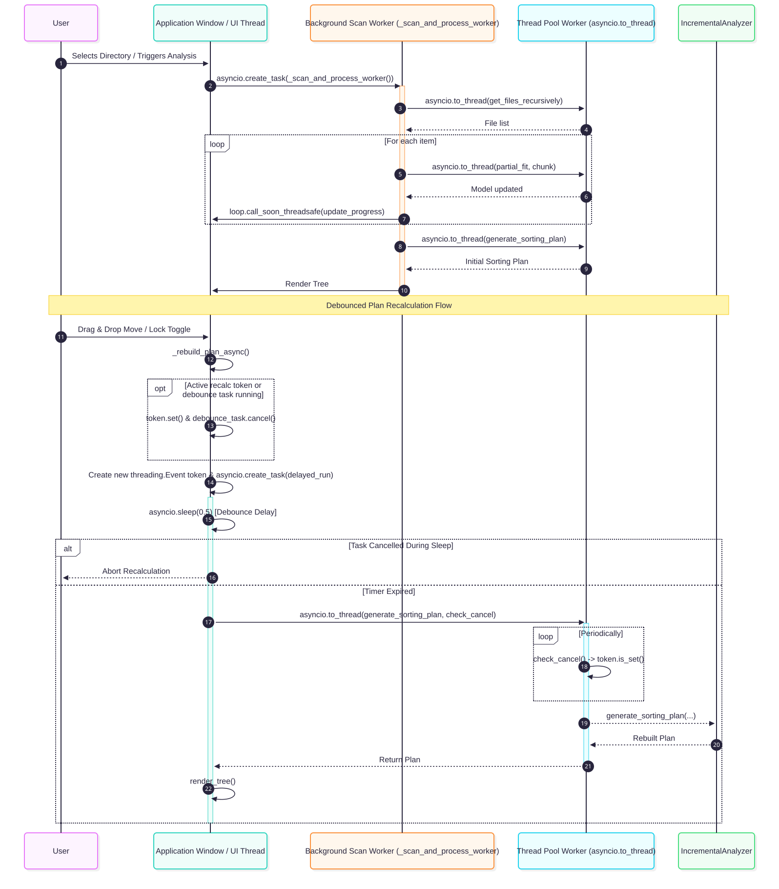

# Architecture & Internals

## Data Flow: Directory Selection to Sorting Plan

The system relies on an automated, pipelined data flow from the moment the user selects a directory to the generation of the final sorting plan.

### 1. Data Extraction
When a directory is selected, `get_files_recursively` (`app/core/scanner.py`) lists its files and `build_corpus_generator` (`app/core/extractor.py`) extracts their text on the shared worker pool, yielding results in chunks of 50. Supported formats are TXT, DOCX, CSV, XLSX/XLS and PDF, plus images (OCR) and audio (Whisper) when the `ml` extra is installed.

### 2. ML Clustering & Recursive Analysis

See [IncrementalAnalyzer][app.core.analyzer.IncrementalAnalyzer] for details on the core incremental ingestion logic.

See [RecursiveKMeansStrategy][app.core.analyzer_strategies.RecursiveKMeansStrategy] for details on the hierarchical clustering approach used for deep folder structures.

### 3. Folder Naming Logic
Documents left over after rule-based routing are vectorized with TF-IDF, or with ONNX sentence embeddings when the optional model is installed, and grouped with `MiniBatchKMeans` (`k = min(MAX_FOLDERS, documents // 2)`, at least 2). Clustering recurses into each group until it reaches `MAX_DEPTH` (default 5, so at most four levels of nested folders), and `MAX_FOLDERS` caps folders per level rather than in total. Recursion stops when fewer than three documents remain; at the top level those documents go to `Miscellaneous`, deeper down they stay in their parent folder.

With the default strategy, a folder is named from the top two TF-IDF terms of its documents, capitalized and joined with a hyphen (e.g., `Finance-Money`). When AI-assisted naming is enabled, the `generative` strategy asks a local LLM for a 1–4 word name instead.

## Background Work & UI Responsiveness

The terminal UI keeps the interface responsive by running every slow step in a Textual worker thread, not on the UI event loop.

- **Worker threads:** Scanning and plan building run in `@work(thread=True)` workers such as `run_scan_worker` in `app/ui/tui.py`. The worker calls `get_files_recursively`, `MetadataPass.run`, the analyzer's `partial_fit` and `AppSession.generate_sorting_plan` directly, and `exclusive=True` cancels a running scan when a new one starts.
- **UI updates from workers:** Workers never touch widgets directly. Progress and results go back to the UI thread through `App.call_from_thread`, for example `self.call_from_thread(self.rebuild_tree)` once a plan is ready.
- **Plan edits:** Locking, renaming or moving a node in the plan tree updates the plan and calls `rebuild_tree()` straight away; there is no debounce in the TUI.
- **Async core APIs:** The core library also offers `asyncio` entry points for the daemon and IPC server, such as `build_corpus_generator_async` (`app/core/extractor.py`), which offload blocking work with `asyncio.to_thread`. The daemon (`app/core/daemon.py`) debounces file-system events with a `threading.Timer` (`DEBOUNCE_DELAY`, default 0.6 s, capped at `MAX_DEBOUNCE_DELAY`, default 5 s) and hands results to its event loop with `loop.call_soon_threadsafe`.

### Background Processing & Debouncing Sequence Flow

### Directory Watchdog Monitoring State Machine

## Centralized System Utilities & Architectural Guardrails

To prevent redundant patterns, platform-specific path bugs, and visual/functional defects across application scopes, we consolidate all system packaging checks, path character validations, and database directory setups / encryption key lookups.

### Centralized Core Helpers
Shared path and packaging helpers live in `app.core.path_utils`, cryptography in `app.core.crypto` and secret scrubbing in `app.core.text_utils`. Direct usage of custom platform or frozen bundle hacks is strictly prohibited.
* **Packaging and Bundle Detections:** The unified helper `is_packaged()` in `app.core.path_utils` checks `sys.frozen` to detect if the app is running in a PyInstaller frozen bundle.
* **Path Sanitization & Name Validation:** Standard validations such as `validate_target_path()`, `sanitize_name()`, and `is_valid_name()` standardize path checking across the application, adhering to OS limits and avoiding platform-specific path errors.
* **Quarantine Target Path & Boundary Validation:** `QuarantineInterceptorService.resolve_safe_target_dir()` verifies target output subfolders using `validate_target_path()` and enforces containment within the base directory via `is_subpath_or_equal()` (`app/core/mover.py`), safely falling back to default subfolders if path traversal or illegal characters are detected.
* **Session and Data Directory Resolution:** Session setup is centralized in `setup_session_directory()` and encryption key lookup is handled via `resolve_db_crypto()`.
* **Centralized Cryptographic & Key Management Facade:** Cryptographic key derivation (SHA-256 with legacy MD5 migration), envelope encryption for proxy settings, and ephemeral bootstrap keys are managed by `CryptoManager` (`app.core.crypto`).
* **Unified Secret Scrubbing Delegate:** All secret scrubbing and diagnostic credential masking delegates to `sanitize_secret_patterns()` in `app.core.text_utils`, eliminating duplicate regex definitions across logging and text filtering.

### Automated Commit-Stage Linting
The `validate-architecture` pre-commit hook (`scripts/validate_architecture.py`, also run in CI) parses changed Python files and rejects re-introduced copies of centralized helpers, such as hardcoded illegal path characters (e.g., `<>:"|?*`), direct `sys.frozen` checks, or raw `secret.key` references outside of `path_utils.py`. The older `scripts/validate_duplicates.py` is deprecated.

## Command-Line Interface

`build_parser` in `app/main.py` defines the top-level options (such as `--tui`) and these subcommands:

| Subcommand | Purpose |
|---|---|
| `sort` | Scan, plan and move files in a folder (`--dry-run` previews the plan) |
| `scan` | Scan and analyse a folder without moving anything |
| `config` | Show or change saved settings |
| `daemon` | Watch folders and sort new files continuously |
| `undo` | List sessions or roll one back |
| `drop` | Triage specific files or folders, like the TUI DropZone |

Further domain subcommands are registered from `app/cli/` by `register_cli_subcommands` and dispatched by `handle_cli_command` (`app/cli/__init__.py`):

- **`ledger` (`app/cli/ledger_cli.py`)**: transaction ledger `status`, `reconcile` (recover interrupted operations), `purge` and `export` (CSV or JSON audit export).
- **`quarantine` (`app/cli/quarantine_cli.py`)**: `list` and `inspect` staged items, `process` (forensic scan) and `release`.

The `ledger` and `quarantine` sub-actions each accept `--json`, `--quiet`/`-q` and `--no-color`, write structured output to `stdout` and logs and progress to `stderr`, and close their database connections in `finally` blocks so file locks are released on every platform.

## Dual-Barrier Sensitivity Compliance System

Sortify enforces defense-in-depth protection for sensitive documents (e.g. medical, financial, legal, PII) across both staging and physical execution phases.

### 1. Upstream Staging Barrier (Phase 0)
The `QuarantineInterceptorService` integrates with `JevClassifierEngine` during Phase 0 triage. Any document assigned a sensitive rating (matching `AUTO_QUARANTINE_RATINGS`, such as `CRITICAL` or `HIGH`) is immediately transitioned to `QUARANTINED` status with policy action `sensitivity_hold` and logged in `quarantine_records`. The `ContinuousWatchdogDaemon` recognizes `sensitivity_hold` as terminal, halting fast-path plan generation or Phase 2 slow-path classification.

### 2. Downstream Execution Barrier (Physical Moves)
During plan move execution in `AsyncMoveEngine`, plan node sensitivity metadata (`sensitivity_rating`, `sensitivity_score`) recorded by `FileAnalyzer` is evaluated prior to physical move execution. If a plan node contains a sensitive rating matching `AUTO_QUARANTINE_RATINGS`, standard folder movement is blocked and the file is safely redirected to the compliance quarantine directory (`_Compliance_Quarantine` or configured `QUARANTINE_DIR_NAME`) with audit logging recorded in `quarantine_records`.

