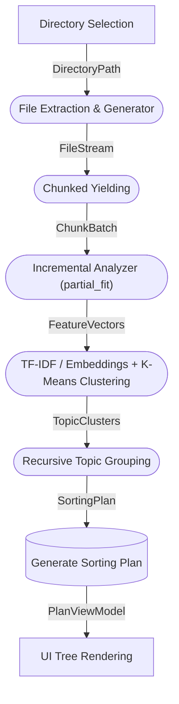
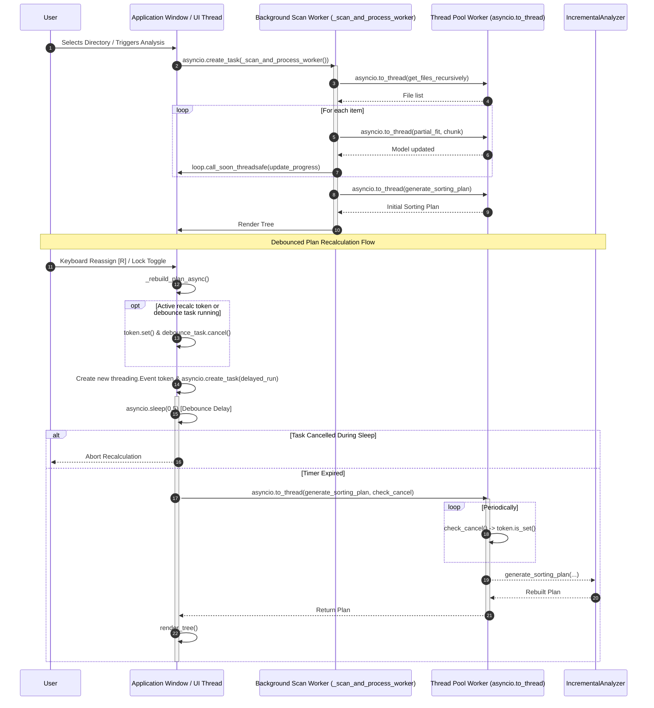
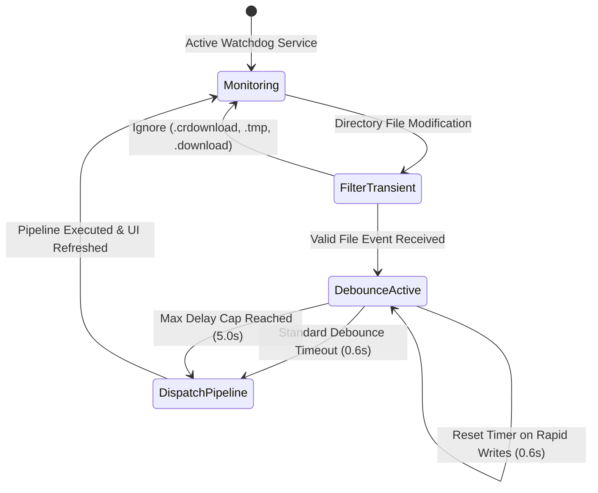
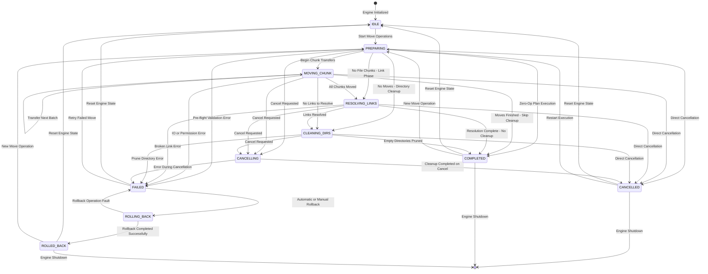
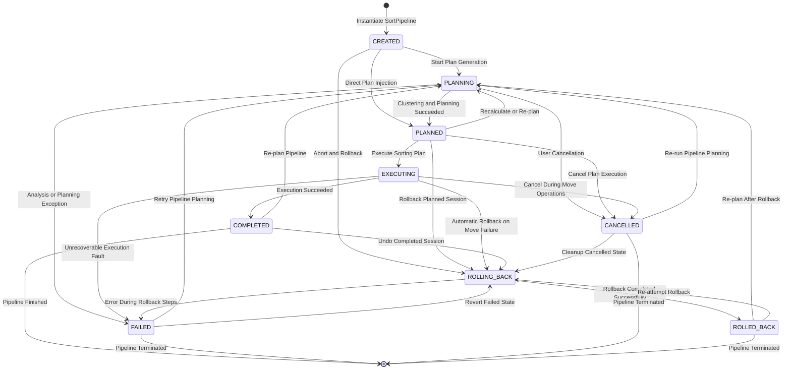
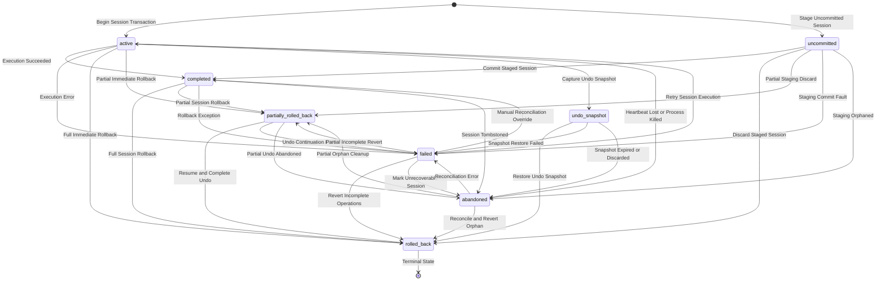
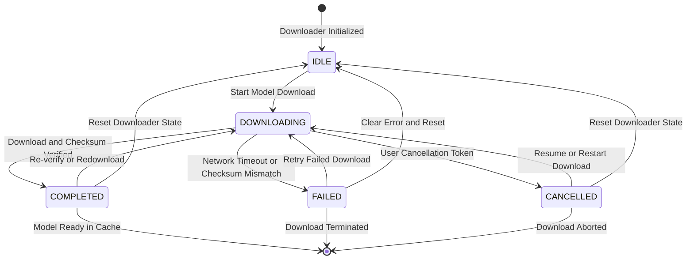

# Architecture & Internals

## Data Flow: Directory Selection to Sorting Plan

The system relies on an automated, pipelined data flow from the moment the user selects a directory to the generation of the final sorting plan.

### 1. Data Extraction
When a directory is selected, `get_files_recursively` (`app/core/scanner.py`) lists its files and `build_corpus_generator` (`app/core/extractor.py`) extracts their text on the shared worker pool, yielding results in chunks of 50. Supported formats are TXT, DOCX, CSV, XLSX/XLS and PDF, plus images (OCR) and audio (Whisper) when the `ml` extra is installed.

### 2. ML Clustering & Recursive Analysis

See [IncrementalAnalyzer][app.core.analyzer.IncrementalAnalyzer] for details on the core incremental ingestion logic.

See [RecursiveKMeansStrategy][app.core.analyzer_strategies.RecursiveKMeansStrategy] for details on the hierarchical clustering approach used for deep folder structures.

### 3. Folder Naming Logic
Documents left over after rule-based routing are vectorized with TF-IDF, or with ONNX sentence embeddings when the optional model is installed, and grouped with `MiniBatchKMeans` (`k = min(MAX_FOLDERS, documents // 2)`, at least 2). Clustering recurses into each group until it reaches `MAX_DEPTH` (default 5, so at most four levels of nested folders), and `MAX_FOLDERS` caps folders per level rather than in total. Recursion stops when fewer than three documents remain; at the top level those documents go to `Miscellaneous`, deeper down they stay in their parent folder.

With the default strategy, a folder is named from the top two TF-IDF terms of its documents, capitalized and joined with a hyphen (e.g., `Finance-Money`). When AI-assisted naming is enabled, the `generative` strategy asks a local LLM for a 1–4 word name instead.

## Background Work & UI Responsiveness

The terminal UI keeps the interface responsive by running every slow step in a Textual worker thread, not on the UI event loop.

- **Worker threads:** Scanning and plan building run in `@work(thread=True)` workers such as `run_scan_worker` in `app/ui/tui.py`. The worker calls `get_files_recursively`, `MetadataPass.run`, the analyzer's `partial_fit` and `AppSession.generate_sorting_plan` directly, and `exclusive=True` cancels a running scan when a new one starts.
- **UI updates from workers:** Workers never touch widgets directly. Progress and results go back to the UI thread through `App.call_from_thread`, for example `self.call_from_thread(self.rebuild_tree)` once a plan is ready.
- **Plan edits:** Locking, renaming or moving a node in the plan tree updates the plan and calls `rebuild_tree()` straight away; there is no debounce in the TUI.
- **Async core APIs:** The core library also offers `asyncio` entry points for the daemon and IPC server, such as `build_corpus_generator_async` (`app/core/extractor.py`), which offload blocking work with `asyncio.to_thread`. The daemon (`app/core/daemon.py`) debounces file-system events with a `threading.Timer` (`DEBOUNCE_DELAY`, default 0.6 s, capped at `MAX_DEBOUNCE_DELAY`, default 5 s) and hands results to its event loop with `loop.call_soon_threadsafe`.

### Background Processing & Debouncing Sequence Flow

### Directory Watchdog Monitoring State Machine

## Core Execution Lifecycle State Machines

Sortify's platform runtime relies on formal finite state machines across file movement, pipeline orchestration, transactional history, and remote asset retrieval. Each state machine enforces strict transition rules, pre-flight guardrails, and error recovery hooks to eliminate invalid state transitions and ensure safe transactional recovery.

### Move Engine Lifecycle (`MoveEngineState`)

The [AsyncMoveEngine][app.core.mover.AsyncMoveEngine] (`app/core/mover.py`) coordinates chunked asynchronous physical file moves, path collision avoidance, and folder pruning. Its lifecycle is governed by [MoveEngineState](api_reference.md#appcoremover), which validates all transitions against `_VALID_MOVE_ENGINE_TRANSITIONS`. Invalid transition attempts raise `InvalidMoveStateError`.

| Current State | Target State | Trigger / Event | Error Recovery / Safety Hook |
|---|---|---|---|
| `IDLE` | `PREPARING` | `start_moves()` invoked | Pre-flight validation checks source/destination paths and write permissions |
| `PREPARING` | `MOVING_CHUNK` | File batch ready | Chunk boundary verification; transaction records initialized |
| `PREPARING` | `RESOLVING_LINKS` | Shortcuts or symlinks only | Bypasses file copy phase; validates link targets directly |
| `PREPARING` | `CLEANING_DIRS` | Empty folder cleanup only | Bypasses move phase; targets directory structure pruning |
| `PREPARING` | `COMPLETED` | Zero-operation plan | Finalizes session cleanly without modifying filesystem |
| `PREPARING` | `CANCELLING` / `CANCELLED` | Cancellation requested | Halts initialization; releases resources and cancellation tokens |
| `PREPARING` | `FAILED` | Pre-flight check failure | Halts startup; records exception in ledger; enables rollback |
| `MOVING_CHUNK` | `MOVING_CHUNK` | Batch complete; more chunks remain | Emits chunk progress event; flushes completed ops to ledger |
| `MOVING_CHUNK` | `RESOLVING_LINKS` | All chunks moved; links pending | Transitions to symlink and Windows shortcut target resolution |
| `MOVING_CHUNK` | `CLEANING_DIRS` | All chunks moved; no links to resolve | Proceeds to remove now-empty source directories |
| `MOVING_CHUNK` | `COMPLETED` | All chunks moved; cleanup skipped | Commits transaction ledger as successfully completed |
| `MOVING_CHUNK` | `CANCELLING` / `CANCELLED` | User or worker cancellation | Suspends active chunk transfers; drains in-flight file operations |
| `MOVING_CHUNK` | `FAILED` | File move IO or permission error | Enters failure handling; initiates automatic rollback if configured |
| `RESOLVING_LINKS` | `CLEANING_DIRS` | Links resolved | Enters source folder pruning phase |
| `RESOLVING_LINKS` | `COMPLETED` | Links resolved; cleanup skipped | Commits transaction ledger as completed |
| `RESOLVING_LINKS` | `CANCELLING` / `CANCELLED` | Cancellation during link phase | Aborts remaining link updates; preserves files moved so far |
| `RESOLVING_LINKS` | `FAILED` | Link creation or resolution error | Captures failure details in transaction record |
| `CLEANING_DIRS` | `COMPLETED` | Source folder pruning finished | Finalizes file moves; records session summary and telemetry |
| `CLEANING_DIRS` | `CANCELLING` / `CANCELLED` | Cancellation during cleanup | Leaves remaining empty directories intact; terminates run |
| `CLEANING_DIRS` | `FAILED` | Directory deletion permission error | Records non-fatal cleanup error; preserves moved files |
| `CANCELLING` | `CANCELLED` | Cancellation drain completed | Confirms all workers stopped and temporary locks released |
| `CANCELLING` | `FAILED` | Unrecoverable cancellation error | Logs critical cancellation exception for debugging |
| `CANCELLED` | `IDLE` / `PREPARING` | Engine reset or retry | Reinitializes cancellation tokens for next run |
| `FAILED` | `ROLLING_BACK` | Rollback triggered or requested | Executes reverse operations recorded in transaction ledger |
| `FAILED` | `IDLE` / `PREPARING` | Engine reset or retry | Clears error status and prepares engine for reuse |
| `ROLLING_BACK` | `ROLLED_BACK` | Inverse moves complete and verified | Restores files to original paths; marks transaction rolled back |
| `ROLLING_BACK` | `FAILED` | Secondary failure during rollback | Preserves partial undo ledger for manual administrator recovery |
| `ROLLED_BACK` | `IDLE` / `PREPARING` | Engine reset or new move | Clears rollback context; resets engine for subsequent runs |
| `COMPLETED` | `IDLE` / `PREPARING` | Engine reset or new move | Resets engine state for subsequent sort operations |

### Pipeline Execution Lifecycle (`PipelineLifecycleState`)

The [SortPipeline][app.core.pipeline.SortPipeline] (`app/core/pipeline.py`) coordinates document scanning, ML clustering, sorting plan synthesis, execution, and rollback. Pipeline states are defined by [PipelineLifecycleState](api_reference.md#appcorepipeline) and validated against `_ALLOWED_TRANSITIONS`. Invalid transitions raise `IllegalStateTransitionError`.

| Current State | Target State | Trigger / Event | Error Recovery / Safety Hook |
|---|---|---|---|
| `CREATED` | `PLANNING` | `plan()` invoked | Initiates background scanning, feature extraction, and clustering |
| `CREATED` | `PLANNED` | Direct plan injection | Pre-computed plan supplied; skips scanning and analysis phases |
| `CREATED` | `ROLLING_BACK` | Immediate rollback called | Enters rollback flow directly on initialized pipeline instance |
| `PLANNING` | `PLANNED` | Plan generation succeeds | Emits planned event; sorting plan verified by verifier |
| `PLANNING` | `FAILED` | Extraction or clustering failure | Captures exception stack trace; halts pipeline execution |
| `PLANNING` | `CANCELLED` | Cancellation token signalled | Cancels worker pool extraction tasks; cleans up temp artifacts |
| `PLANNED` | `EXECUTING` | `execute()` invoked | Passes verified sorting plan to `AsyncMoveEngine` |
| `PLANNED` | `PLANNING` | Re-plan or parameter adjustment | Clears existing plan; re-runs clustering with updated settings |
| `PLANNED` | `CANCELLED` | Cancellation before execution | Discards plan safely without mutating any target files |
| `PLANNED` | `ROLLING_BACK` | Rollback requested on plan | Aborts planned session; triggers cleanup hooks |
| `EXECUTING` | `COMPLETED` | All file operations completed | Records completed execution metrics; releases session locks |
| `EXECUTING` | `CANCELLED` | Cancellation during move execution | Signals `AsyncMoveEngine` cancel; preserves partial state |
| `EXECUTING` | `ROLLING_BACK` | Auto-rollback on move failure | Automatically triggers inverse operations to revert displaced files |
| `EXECUTING` | `FAILED` | Unhandled execution exception | Records error details in pipeline result; preserves state |
| `ROLLING_BACK` | `ROLLED_BACK` | Rollback steps complete | Reverts all displaced files; updates session ledger to rolled back |
| `ROLLING_BACK` | `FAILED` | Rollback step failure | Flags partial rollback; saves audit log for manual recovery |
| `COMPLETED` | `PLANNING` | Pipeline re-run requested | Re-arms pipeline instance for subsequent planning pass |
| `COMPLETED` | `ROLLING_BACK` | Session rollback requested (`undo`) | Initiates reversal of completed operations from session history |
| `FAILED` | `PLANNING` | Planning retry | Clears error flag; restarts planning workflow |
| `FAILED` | `ROLLING_BACK` | Revert failed operations | Rolls back any files moved prior to the failure |
| `CANCELLED` | `PLANNING` | Planning restart | Reinitializes pipeline state for fresh run |
| `CANCELLED` | `ROLLING_BACK` | Cleanup cancelled operations | Reverts any files moved before cancellation signal |
| `ROLLED_BACK` | `PLANNING` | New planning pass | Starts new planning cycle following clean rollback |
| `ROLLED_BACK` | `ROLLING_BACK` | Resume / repeat rollback | Continues rollback from last verified checkpoint |

### Session History Transaction State Machine (`SessionStateMachine`)

Sortify's audit ledger and history service (`app/core/history.py`) maintains ACID guarantees and audit trails for sorting sessions. Transitions are validated by [SessionStateMachine](api_reference.md#appcorehistory) against `TRANSITION_MATRIX`. Disallowed transitions raise `InvalidStateTransitionError`. Every state transition records an entry in `session_lifecycle_audit`.

| Current Status | Target Status | Trigger / Event | Audit & Recovery Hook |
|---|---|---|---|
| `uncommitted` | `completed` | Direct transaction commit | Atomically commits session; records audit ledger entry |
| `uncommitted` | `rolled_back` | Discard staged session | Removes uncommitted changes without modifying historical records |
| `uncommitted` | `partially_rolled_back` | Partial discard of uncommitted items | Retains remaining staging entries for inspection |
| `uncommitted` | `failed` | Staging or commit error | Records error details in lifecycle audit table |
| `uncommitted` | `abandoned` | Staged session abandoned | Marks session orphaned; eligible for reconciliation purge |
| `active` | `completed` | File operations completed | Logs completion timestamp and telemetry event |
| `active` | `failed` | Uncaught execution exception | Captures stack trace and error message in audit ledger |
| `active` | `rolled_back` | Full immediate rollback | Reverts all recorded file moves in a single atomic transaction |
| `active` | `partially_rolled_back` | Partial rollback executed | Records partially reverted status and affected file IDs |
| `active` | `undo_snapshot` | Pre-execution snapshot captured | Persists filesystem undo points for deferred recovery |
| `active` | `abandoned` | Process termination or lost heartbeat | Enables reconciliation recovery via `ledger reconcile` |
| `completed` | `rolled_back` | Full rollback requested (`undo`) | Reverses all file operations; records audit ledger event |
| `completed` | `partially_rolled_back` | Partial undo requested | Reverses subset of files; leaves remaining in completed status |
| `completed` | `failed` | Error during undo attempt | Logs failure; preserves ledger for subsequent retry |
| `completed` | `abandoned` | Session tombstoned or archived | Preserves session record while disabling active operations |
| `partially_rolled_back` | `rolled_back` | Undo resumes and completes | Fully reconciles session to terminal rolled back status |
| `partially_rolled_back` | `failed` | Error during resumed rollback | Keeps session in partially rolled back state for retry |
| `partially_rolled_back` | `abandoned` | Incomplete undo abandoned | Marks remaining undo steps abandoned |
| `undo_snapshot` | `rolled_back` | Snapshot restored | Reverts filesystem to captured snapshot state |
| `undo_snapshot` | `failed` | Snapshot restoration error | Records restoration failure in lifecycle audit |
| `undo_snapshot` | `abandoned` | Snapshot expired or dismissed | Releases snapshot storage safely |
| `failed` | `active` | Retry session execution | Re-enables active status for reconciliation |
| `failed` | `completed` | Manual reconciliation override | Marks session resolved after administrative verification |
| `failed` | `rolled_back` | Revert partial operations of failed run | Undoes moves that succeeded before failure occurred |
| `failed` | `partially_rolled_back` | Partial revert of failed session | Reverts recoverable operations |
| `failed` | `abandoned` | Mark session irrecoverable | Abandons automated recovery; flags for audit review |
| `abandoned` | `rolled_back` | `ledger reconcile` recovers orphan | Reverts orphan session moves to clean original state |
| `abandoned` | `partially_rolled_back` | Partial recovery of orphan | Recovers accessible files |
| `abandoned` | `failed` | Reconciliation error | Re-logs failure details in audit table |
| `rolled_back` | `rolled_back` | Idempotent terminal transition | Re-validates already rolled-back state safely |

### Model Downloader Lifecycle (`DownloadState`)

The [DownloadManager][app.core.downloader.DownloadManager] (`app/core/downloader.py`) manages model downloads for OCR and neural embedding models. Its operational phases are tracked by [DownloadState](api_reference.md#appcoredownloader) and validated against `_VALID_TRANSITIONS`.

Before downloading, the model downloader validates the download URL against strict security invariants. All model download requests require the HTTPS scheme. Plain HTTP and other schemes are rejected. Allowed download hosts are restricted to `ALLOWED_MODEL_HOSTS`: `huggingface.co` and `hf.co` (including trusted subdomains, plus any custom hosts explicitly configured in `TRUSTED_MODEL_HOSTS`). The downloader blocks all IP address literals, including private, loopback, link-local, and public addresses, to prevent SSRF attacks. Local hostnames such as `localhost` and `.local` are also blocked.

| Current State | Target State | Trigger / Event | Error Recovery / Safety Hook |
|---|---|---|---|
| `IDLE` | `DOWNLOADING` | Model download initiated | Pre-allocates cache directory; creates `.tmp` download file |
| `DOWNLOADING` | `COMPLETED` | Stream complete & checksum verified | Atomically moves `.tmp` file to target model path; notifies listeners |
| `DOWNLOADING` | `FAILED` | Network timeout or checksum mismatch | Deletes temporary file; records error; notifies error listeners |
| `DOWNLOADING` | `CANCELLED` | User cancel requested (`cancel()`) | Aborts HTTP stream; purges incomplete `.tmp` file; raises `DownloadCancelledError` |
| `COMPLETED` | `DOWNLOADING` | Re-download or update check | Re-initiates streaming if cache invalidated or model corrupted |
| `COMPLETED` | `IDLE` | Downloader reset | Prepares downloader instance for subsequent model fetch |
| `FAILED` | `DOWNLOADING` | Download retry initiated | Retries network request with exponential backoff if enabled |
| `FAILED` | `IDLE` | Clear error / reset | Clears error message and resets downloader state |
| `CANCELLED` | `DOWNLOADING` | Resume or restart download | Cleans up previous partial state and restarts download |
| `CANCELLED` | `IDLE` | Downloader reset | Clears cancelled status and returns to idle readiness |

## Centralized System Utilities & Architectural Guardrails

To prevent redundant patterns, platform-specific path bugs, and visual/functional defects across application scopes, we consolidate all system packaging checks, path character validations, and database directory setups / encryption key lookups.

### Centralized Core Helpers
Shared path and packaging helpers live in `app.core.path_utils`, cryptography in `app.core.crypto` and secret scrubbing in `app.core.text_utils`. Direct usage of custom platform or frozen bundle hacks is strictly prohibited.
* **Packaging and Bundle Detections:** The unified helper `is_packaged()` in `app.core.path_utils` checks `sys.frozen` to detect if the app is running in a PyInstaller frozen bundle.
* **Path Sanitization & Name Validation:** Standard validations such as `validate_target_path()`, `sanitize_name()`, and `is_valid_name()` standardize path checking across the application, adhering to OS limits and avoiding platform-specific path errors.
* **Quarantine Target Path & Boundary Validation:** `QuarantineInterceptorService.resolve_safe_target_dir()` verifies target output subfolders using `validate_target_path()` and enforces containment within the base directory via `is_subpath_or_equal()` (`app/core/mover.py`), safely falling back to default subfolders if path traversal or illegal characters are detected.
* **Session and Data Directory Resolution:** Session setup is centralized in `setup_session_directory()` and encryption key lookup is handled via `resolve_db_crypto()`.
* **Centralized Cryptographic & Key Management Facade:** Cryptographic key derivation (SHA-256 with legacy MD5 migration), envelope encryption for proxy settings, and ephemeral bootstrap keys are managed by `CryptoManager` (`app.core.crypto`).
* **Unified Secret Scrubbing Delegate:** All secret scrubbing and diagnostic credential masking delegates to `sanitize_secret_patterns()` in `app.core.text_utils`, eliminating duplicate regex definitions across logging and text filtering.

### Automated Commit-Stage Linting
The `validate-architecture` pre-commit hook (`scripts/validate_architecture.py`, also run in CI) parses changed Python files and rejects re-introduced copies of centralized helpers, such as hardcoded illegal path characters (e.g., `<>:"|?*`), direct `sys.frozen` checks, or raw `secret.key` references outside of `path_utils.py`.

## Command-Line Interface

`build_parser` in `app/main.py` defines the top-level options (such as `--tui`) and these subcommands:

| Subcommand | Purpose |
|---|---|
| `sort` | Scan, plan and move files in a folder (`--dry-run` previews the plan) |
| `scan` | Scan and analyse a folder without moving anything |
| `config` | Show or change saved settings |
| `daemon` | Watch folders and sort new files continuously |
| `undo` | List sessions or roll one back |
| `drop` | Triage specific files or folders, like the TUI DropZone |

Further domain subcommands are registered from `app/cli/` by `register_cli_subcommands` and dispatched by `handle_cli_command` (`app/cli/__init__.py`):

- **`ledger` (`app/cli/ledger_cli.py`)**: transaction ledger `status`, `reconcile` (recover interrupted operations), `purge` and `export` (CSV or JSON audit export).
- **`quarantine` (`app/cli/quarantine_cli.py`)**: `list` and `inspect` staged items, `process` (forensic scan) and `release`.

The `ledger` and `quarantine` sub-actions each accept `--json`, `--quiet`/`-q` and `--no-color`, write structured output to `stdout` and logs and progress to `stderr`, and close their database connections in `finally` blocks so file locks are released on every platform.

## Dual-Barrier Sensitivity Compliance System

Sortify enforces defense-in-depth protection for sensitive documents (e.g. medical, financial, legal, PII) across both staging and physical execution phases.

### 1. Upstream Staging Barrier (Phase 0)
The `QuarantineInterceptorService` integrates with `JevClassifierEngine` during Phase 0 triage. Any document assigned a sensitive rating (matching `AUTO_QUARANTINE_RATINGS`, such as `CRITICAL` or `HIGH`) is immediately transitioned to `QUARANTINED` status with policy action `sensitivity_hold` and logged in `quarantine_records`. The `ContinuousWatchdogDaemon` recognizes `sensitivity_hold` as terminal, halting fast-path plan generation or Phase 2 slow-path classification.

### 2. Downstream Execution Barrier (Physical Moves)
During plan move execution in `AsyncMoveEngine`, plan node sensitivity metadata (`sensitivity_rating`, `sensitivity_score`) recorded by `FileAnalyzer` is evaluated prior to physical move execution. If a plan node contains a sensitive rating matching `AUTO_QUARANTINE_RATINGS`, standard folder movement is blocked and the file is safely redirected to the compliance quarantine directory (`_Compliance_Quarantine` or configured `QUARANTINE_DIR_NAME`) with audit logging recorded in `quarantine_records`.

## Managed store services

`app.core.services.acquire_services()` is the composition root for database,
cache and history access. Hold its context-managed lease for the whole command
or background operation. Canonical store paths share one writer and service
graph in a process. Closing an export, dialog or session releases its lease;
only the final consumer drains and stops the writer. Consumers never call
`worker.stop()` or clear other consumers' connections. Custom quarantine
databases use the same ownership rule and retain their standalone schema.

Store bootstrap runs on the writer. Session close does not unload global models
or shut down shared pools; those resources belong to application shutdown.
Legacy query/schema ownership remains tracked separately in #712.
