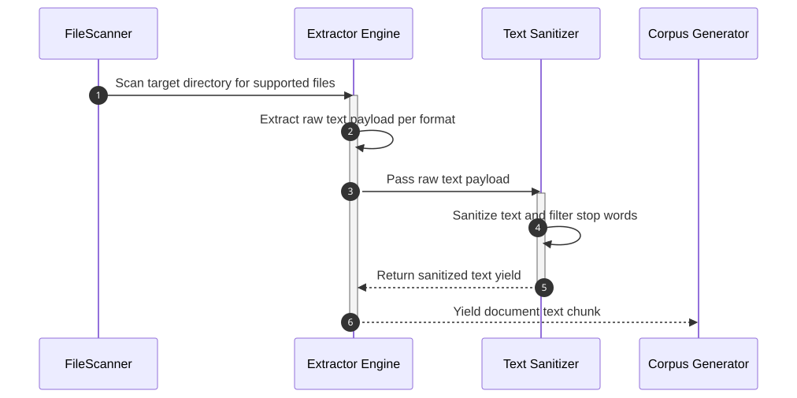

# Core API Reference

This document outlines the core internal workflow and architecture of the Smart Autosorter system, detailing how extraction, analysis, and verification are coordinated.

## Workflow Guide: Extractor and Analyzer

The system uses a two-phase pipeline to convert documents into structured sorting plans:

1. **Extraction (`app.core.extractor`)**:
    - The extractor reads raw files across multiple supported formats (TXT, CSV, PDF, DOCX, XLSX/XLS, plus images via OCR and audio via Whisper when the `ml` extra is installed).
    - It maps each file to its raw text payload using robust exception-handling to ensure that a failure in one document does not crash the entire run.
    - `build_corpus_generator` submits files to the shared worker pool and yields the extracted text in chunks of 50 to keep memory use low. `build_corpus_generator_async` is the `asyncio` variant used by the daemon.

2. **Analysis (`app.core.analyzer`)**:
    - Extracted text chunks are fed incrementally into the `IncrementalAnalyzer`.
    - `TfidfVectorizer` transforms the text into sparse vectors; when the optional ONNX model is installed, sentence embeddings are used instead.
    - `MiniBatchKMeans` groups the vectors, and the strategy recurses into each group to build a hierarchical sorting plan with sub-folders where appropriate.
    - Each folder is named from its documents' top TF-IDF terms, or by a local LLM when AI-assisted naming is enabled.

## Multi-Study Clinical Ingestion Pipeline

## Centralized In-Memory Caching Architecture

## Concurrency & Worker Pool Model

## Verifier Logic

Before any files are moved, `VerificationEngine.verify_integrity` (`app.core.verifier`) checks the sorting plan and reports problems by category:

- **Collisions**: two files planned for the same destination, or a destination whose parent path is blocked by a file.
- **Circular renames**: moves that would swap or cycle file names.
- **Broken links**: symlinks and Windows shortcuts whose targets would break after the moves.
- **Escaping paths**: destinations that would resolve outside the target folder.
- **Long paths**: destinations longer than 260 characters. The same limit is applied on every OS.
- **Invalid or unconfirmed renames**: proposed names with illegal characters or a changed extension, and renames the user hasn't confirmed.

It does not check free disk space or whether a source file is locked by another program; those failures surface during the move itself.

---

## Module Definitions

### Fast-Path Triage Engine (`app.core.jev_classifier`)

The `JevClassifierEngine` provides ultra-fast, local, non-generative document triage and classification designed to enforce a sub-150ms per-file SLA.

- **In-Engine Fast Snippet Extraction**: When callers omit pre-extracted `text_content`, the engine automatically performs lightweight header snippet extraction directly from binary and PDF files under 10MB:
  - `.pdf`: Reads page 0 text (up to 4096 characters) using `pypdf.PdfReader`.
  - `.docx`: Reads initial paragraph text (up to 4096 characters) using `docx.Document`.
  - `.xlsx`: Reads initial rows from sheet 0 (up to 4096 characters) using `openpyxl.load_workbook`.
  - `.xls`: Reads initial rows from sheet 0 (up to 4096 characters) using `xlrd.open_workbook`.
  - `.pptx`: Reads text from slide 0 (up to 4096 characters) using `pptx.Presentation`.
- **Stream Descriptor Resilience**: All document readers accept string or `Path` file paths wrapped in explicit `with open(file_path, "rb") as f:` binary context managers or internal stream lifecycle managers, ensuring file descriptors are released immediately and preventing file handle locking (`WinError 32`) on Windows platforms.
- **Rule-Based Triage & Caching**: Combines category keyword and extension matching with two-tier in-memory caching (`BoundedMemoryCache`), assigning sensitivity ratings, archival priorities, and confidence scores without invoking heavy LLM inference.
