# Smart AutoSorter AI Pro

Smart AutoSorter AI Pro (package `smart-autosorter`, displayed as **Sortify AI Pro** in the terminal interface) is a local, offline-first document organizer. It scans a directory, extracts document text across common office and media formats, applies deterministic routing rules before content clustering, and moves files into a structured folder tree with full undo support.



## Key Capabilities

- **Rules first, clustering second.** Locked paths, compliance policies, sensitivity quarantine rules, keyword and imported rules, learned corrections, and file-extension categories run before unsupervised clustering.
- **Offline content clustering.** Remaining documents are vectorized with TF-IDF (or local ONNX sentence embeddings when optional ML extras are installed) and grouped hierarchically with `MiniBatchKMeans`. Folders are named from top TF-IDF terms or by a local LLM when generative naming is enabled.
- **Multi-format text extraction.** Extracts text from `.txt`, `.docx`, `.csv`, `.xlsx`, `.xls`, and `.pdf` out of the box, plus images (`.png`, `.jpg`, `.jpeg`) via OCR and audio (`.mp3`, `.wav`, `.m4a`) via Whisper when the `ml` extra is installed.
- **Verified, reversible file moves.** A pre-flight verifier checks every sorting plan for collisions, path-length limits, and directory boundary violations before touching the filesystem. Physical moves are journaled in a transactional ledger and can be rolled back with `undo`.
- **Encrypted local state.** Extracted text and embeddings are stored in a local SQLCipher database with column-level encryption; keys are managed through the OS keyring with a permission-restricted fallback key file.
- **Three runtime modes.** Drive sorting interactively in the Textual terminal UI (TUI), automate workflows from the scriptable CLI, or monitor folders continuously with the background daemon.

## Quick Start

Install from source with [uv](https://docs.astral.sh/uv/) and Python 3.12:

```bash
git clone https://github.com/fderuiter/sortify.git
cd sortify
uv sync                 # core install (TF-IDF offline clustering)
uv sync --extra ml      # optional: OCR, audio transcription, ONNX embeddings, local LLM naming
```

### Terminal UI (TUI)

Launch the full-screen terminal interface to browse directories, inspect and customize proposed folder trees, manage rules, and execute verified moves:

```bash
uv run smart-autosorter
uv run smart-autosorter --tui
```

Press `[Ctrl+B]` to choose a directory, `[Ctrl+S]` to scan and preview the plan, `[Ctrl+K]` to open the searchable Command Palette, `[Ctrl+E]` to execute verified moves, and `[?]` or `[F1]` to view shortcuts.

### Command Line (CLI)

Preview plans, run dry-run verifications, sort directories, or roll back the latest transaction directly from your shell:

```bash
uv run smart-autosorter scan ~/Downloads            # print proposed folder tree without moving files
uv run smart-autosorter sort ~/Downloads --dry-run  # run pre-flight verification without moving files
uv run smart-autosorter sort ~/Downloads            # execute verified sort in place
uv run smart-autosorter undo --latest               # roll back the most recent sort session
uv run smart-autosorter --demo                      # run end-to-end demo on a generated sample corpus
uv run smart-autosorter --help                      # list all subcommands and options
```

## Documentation Guide

### User & Administrator Guides

- [User Guide](user_guide.md) — First-run setup wizard, TUI workflows, CLI flags, rule management, imported rule migration, and undo history.
- [Keyboard Shortcuts](keyboard_shortcuts.md) — Complete keybinding reference across the main TUI workspace and modal dialogs.
- [Administrator Guide](admin_guide.md) — Layered configuration (`SORTIFY_` environment variables, `settings.json`, CLI flags), compliance policies, and enterprise deployment controls.
- [Troubleshooting](troubleshooting.md) — Solutions for common setup, permission, model download, keyring, and recovery issues.

### Interactive Tutorials & Runbooks

- [Stateful ML Analyzer Clustering](tutorials/01_ml_analyzer_clustering.md) — Walkthrough of incremental TF-IDF / embedding ingestion and recursive clustering.
- [Multi-Format Text Extraction](tutorials/02_multi_format_text_extraction.md) — How documents, spreadsheets, PDFs, images, and audio files are parsed into text chunks.
- [Virtual Sorting Verification](tutorials/03_virtual_sorting_verification.md) — Pre-flight collision checks and dry-run simulation before physical moves.
- [Ledger Reconciliation Runbook](runbooks/ledger_reconciliation.md) — Operational recovery procedures for inspecting and reconciling move ledger states.

### Developer Reference

- [Architecture & Internals](architecture.md) — End-to-end data flow, worker concurrency, state machines, and security boundaries.
- [API Reference](api_reference.md) — Auto-generated Python module, class, and function reference.
- [Contributor Guide](contributor.md) — Local development setup, test commands, and shared utility conventions.
- [Core Developer Guide](core.md) & [UI Developer Guide](ui.md) — Deep dives into `app/core/` backend subsystems and `app/ui/` Textual components.
- [Auto-Merge Policy](auto_merge_policy.md) & [Branch Protection Rules](branch_protection.md) — Repository risk tiers, CI gates, and merge governance.
