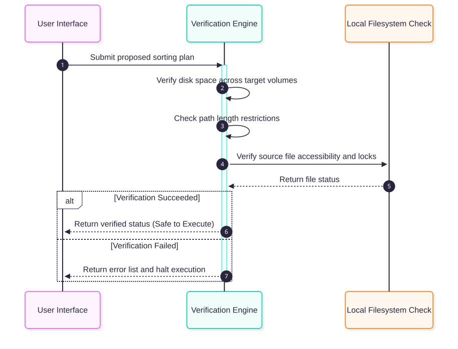

# Virtual Sorting Verification & Safe Simulation Testing

## 1. Context & Overview
Before performing physical move/rename operations on a user's filesystem, **Smart AutoSorter AI Pro** executes a proactive, in-memory dry run verification using the `VerificationEngine`.

This safety check guarantees:
1. **No dynamic path collisions**: Preventing multiple source files from overwriting each other if they are assigned to the same target path.
2. **No invalid/long paths**: Detecting and warning if any generated destination paths violate the standard operating system character limits (e.g. 260 character limit on Windows).
3. **Safe Simulation**: Performing validation entirely in memory without actually writing, copying, or deleting any files on disk.

### Virtual Verification Pipeline Flow


```python
import json
import os
import tempfile

# Core Smart AutoSorter imports
from app.core.verifier import VerificationEngine
```

## 2. Sandbox Setup
We'll instantiate a clean sandbox directory to mock our local filesystem base path.

```python
# Setup mock workspace
sandbox_dir = tempfile.TemporaryDirectory()
base_dir = os.path.normpath(sandbox_dir.name)
print(f"[*] Safe mock workspace base dir: {base_dir}")
```

## 3. Scenario 1: Normal Sorting Operations (Successful Validation)
We configure a clean sorting plan with non-conflicting destinations. Folders are plain nested dictionaries, as the analyzer produces them, and files are nodes with `"__type__": "file"`. (A node with `"__type__": "directory"` means "move this whole folder as one unit", so the verifier does not look inside it.) A rename (`target_filename` different from the source name) only passes once the user has confirmed it, so the plan marks it `confirmed`. The `VerificationEngine` simulates the moves and should report success.

```python
normal_plan = {
    "document_A.txt": {
        "__type__": "file",
        "relative_source": "document_A.txt",
        "target_filename": "document_A.txt",
    },
    "Finance": {
        "document_B.txt": {
            "__type__": "file",
            "relative_source": "document_B.txt",
            "target_filename": "renamed_B.txt",
            "confirmed": True,  # the user approved this rename
        },
    },
}

print("[*] Verifying normal sorting plan integrity...")
result = VerificationEngine.verify_plan_integrity(base_dir, normal_plan)

print("\n[+] Verification Result:")
print(f"  Success: {result['success']}")
print(f"  Warnings: {result['warnings']}")
print(f"  Collisions: {result['collisions']}")
assert result["success"] and not result["collisions"]
```

## 4. Scenario 2: Dynamic Path Collision Detection
Now, let's intentionally introduce a collision where two separate source files are directed to the same destination target file. The `VerificationEngine` must proactively detect this and mark the plan verification as unsuccessful.

```python
colliding_plan = {
    "Finance": {
        "invoice_1.txt": {
            "__type__": "file",
            "relative_source": "invoice_1.txt",
            "target_filename": "clashing_name.txt",
        },
        "receipt_9.txt": {
            "__type__": "file",
            "relative_source": "receipt_9.txt",
            "target_filename": "clashing_name.txt",  # Collision!
        },
    }
}

print("[*] Verifying colliding plan integrity...")
result = VerificationEngine.verify_plan_integrity(base_dir, colliding_plan)

print("\n[-] Verification Result:")
print(f"  Success: {result['success']}")
print(f"  Collisions: {json.dumps(result['collisions'], indent=2)}")
print(f"  Warnings: {result['warnings']}")
assert not result["success"]
assert result["collisions"][0]["type"] == "duplicate_target"
```

Besides the collision, the warnings also flag both renames as lacking user confirmation, because neither node sets `confirmed`.

## 5. Scenario 3: Windows Path Length Warnings Limit Detection
Destinations of 260 characters or more fail verification on every OS, because Windows can't open them by default. We'll simulate a plan containing a filename with 250 characters, which pushes the full destination path over the limit.

```python
long_filename = "x" * 250 + ".txt"
long_path_plan = {
    "short_file.txt": {
        "__type__": "file",
        "relative_source": "short_file.txt",
        "target_filename": long_filename,
    }
}

print("[*] Verifying long-path plan integrity...")
result = VerificationEngine.verify_plan_integrity(base_dir, long_path_plan)

print("\n[-] Verification Result:")
print(f"  Success: {result['success']}")
print(f"  Long Paths Found: {len(result['long_paths'])}")
if result["long_paths"]:
    print(f"  Example long path truncated: {result['long_paths'][0]['path'][:80]}...")
print(f"  Warnings: {result['warnings']}")
assert not result["success"] and len(result["long_paths"]) == 1
```

## 6. Safe Workspace Cleanup
Clean up the temporary sandbox workspace safely.

```python
print("[*] Cleaning up mock sandbox base directory...")
sandbox_dir.cleanup()
print("[+] Workspace deleted. Verification simulation finalized safely!")
```

