# UI API Reference

This document is automatically generated. Do not edit manually.

## Component Architecture & Catalog Diagrams

### Catalog Interactive Workbench Workflow

### UI Component Hierarchy

## `app.ui.a11y`

::: app.ui.a11y

## `app.ui.heading`

::: app.ui.heading

## `app.ui.layout`

::: app.ui.layout

## `app.ui.notifications`

::: app.ui.notifications

## `app.ui.tui`

::: app.ui.tui

## `app.ui.widgets.density_slider`

::: app.ui.widgets.density_slider

## `app.ui.widgets.labeled_switch`

::: app.ui.widgets.labeled_switch

## `app.ui.widgets.path_diff`

::: app.ui.widgets.path_diff

## `app.ui.widgets.vim_tree`

::: app.ui.widgets.vim_tree

