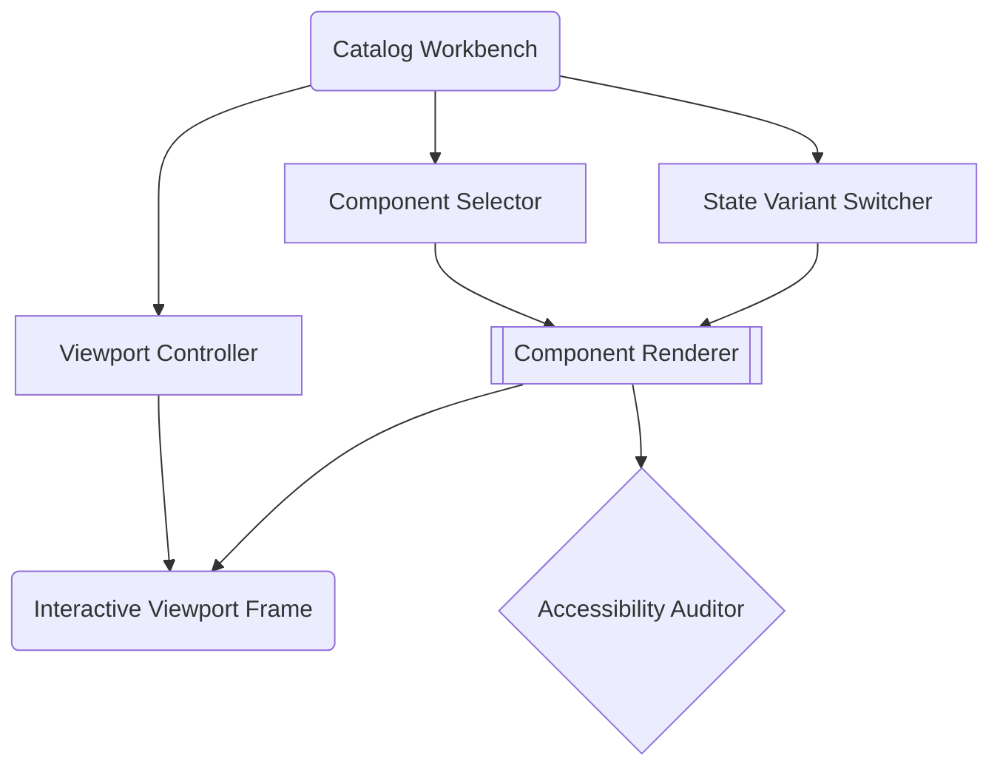
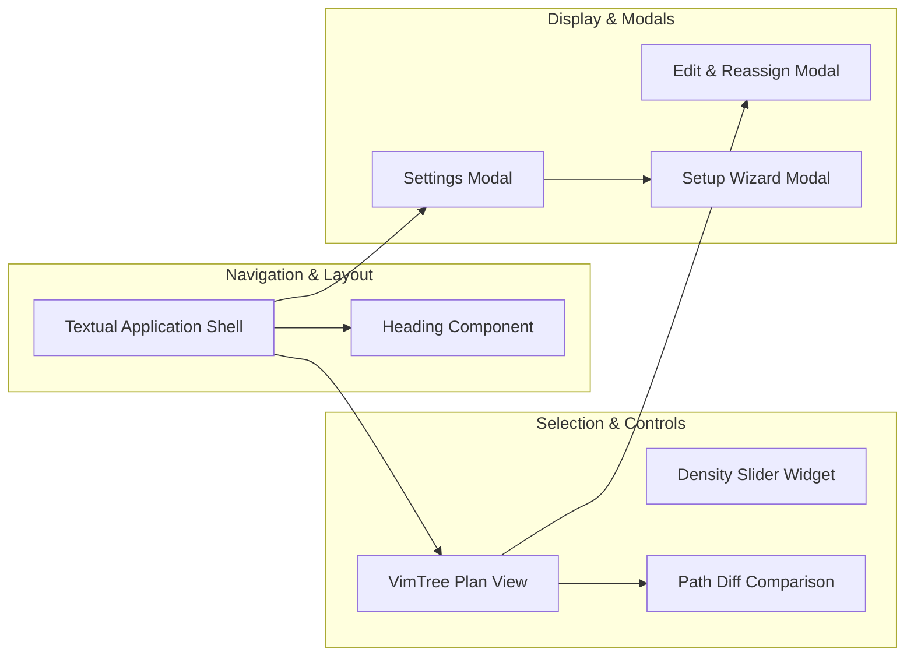

# UI API Reference

This document is automatically generated. Do not edit manually.

## Component Architecture & Catalog Diagrams

### Catalog Interactive Workbench Workflow

### UI Component Hierarchy

## `app.ui.a11y`

::: app.ui.a11y

## `app.ui.ai_runtime`

::: app.ui.ai_runtime

## `app.ui.catalog`

::: app.ui.catalog

## `app.ui.heading`

::: app.ui.heading

## `app.ui.layout`

::: app.ui.layout

## `app.ui.markup_utils`

::: app.ui.markup_utils

## `app.ui.mixins.pipeline`

::: app.ui.mixins.pipeline

## `app.ui.mixins.selection`

::: app.ui.mixins.selection

## `app.ui.mixins.tree_view`

::: app.ui.mixins.tree_view

## `app.ui.modals.command_palette`

::: app.ui.modals.command_palette

## `app.ui.modals.drop_zone`

::: app.ui.modals.drop_zone

## `app.ui.modals.edit`

::: app.ui.modals.edit

## `app.ui.modals.help`

::: app.ui.modals.help

## `app.ui.modals.models`

::: app.ui.modals.models

## `app.ui.modals.quarantine`

::: app.ui.modals.quarantine

## `app.ui.modals.reports`

::: app.ui.modals.reports

## `app.ui.modals.rules`

::: app.ui.modals.rules

## `app.ui.modals.sample_playground`

::: app.ui.modals.sample_playground

## `app.ui.modals.session`

::: app.ui.modals.session

## `app.ui.modals.settings`

::: app.ui.modals.settings

## `app.ui.modals.wizard`

::: app.ui.modals.wizard

## `app.ui.notifications`

::: app.ui.notifications

## `app.ui.protocols`

::: app.ui.protocols

## `app.ui.tree_search`

::: app.ui.tree_search

## `app.ui.tui`

::: app.ui.tui

## `app.ui.widgets.density_slider`

::: app.ui.widgets.density_slider

## `app.ui.widgets.labeled_switch`

::: app.ui.widgets.labeled_switch

## `app.ui.widgets.path_diff`

::: app.ui.widgets.path_diff

## `app.ui.widgets.vim_tree`

::: app.ui.widgets.vim_tree

