# User Guide

Smart AutoSorter AI Pro organizes a folder of documents into a generated folder tree. You can drive it from the full-screen terminal interface (TUI) or from the command line, and every run can be undone.

The examples below use `smart-autosorter`. When running from a source checkout, prefix each command with `uv run`.

## First Run and AI Consent

On first launch the **Privacy & Data Setup Wizard** asks whether you allow the optional AI model download: a one-time, roughly 80 MB embedding model from Hugging Face.


Declining is fine. Sorting still works offline using TF-IDF keyword clustering (see [Offline Mode](#offline-mode)).

### From the command line
- Grant consent and download the model:
  ```bash
  smart-autosorter --accept-ai-consent
  ```
- Decline and stay fully offline:
  ```bash
  smart-autosorter --decline-ai-consent
  ```
- In scripts or other non-interactive environments, add `--non-interactive` (or `--skip-wizard`) so no dialog waits for input:
  ```bash
  smart-autosorter --accept-ai-consent --non-interactive
  ```

### In the terminal interface
The wizard opens automatically on first launch of `smart-autosorter`:
1. Use `[Tab]` / `[Shift+Tab]` to move between the AI Consent switch and the buttons.
2. Press `[Space]` or `[Enter]` on the switch to toggle consent.
3. Highlight **Finish & Save** and press `[Enter]`.

Reopen the wizard any time with `[Ctrl+W]`.

## Sorting a Folder

### In the terminal interface
1. Start the app with `smart-autosorter` (or `smart-autosorter --tui`).
2. Press `[Ctrl+B]` to choose a folder, then `[Ctrl+S]` to scan it. The proposed folder tree appears; nothing has moved yet.
3. Review the plan. `[Ctrl+F]` searches the tree, `[Space]` checks items, `[Ctrl+L]` locks a file in place, `[Ctrl+R]` renames a folder and `[Ctrl+N]` creates one. Drag-and-drop moves files between folders.
4. Press `[Ctrl+E]` to execute. You can review duplicates first, and an audit report is shown when the moves finish.

Press `[?]` or `[F1]` for the full list of shortcuts and `[Ctrl+Q]` to quit. Every shortcut is also listed in [Keyboard Shortcuts](keyboard_shortcuts.md).

### From the command line
```bash
smart-autosorter scan ~/Downloads --json      # print the plan, move nothing
smart-autosorter sort ~/Downloads --dry-run   # verify the plan without moving
smart-autosorter sort ~/Downloads             # sort in place
smart-autosorter sort ~/Downloads --dest-dir ~/Sorted
```

Useful options for `sort` and `scan`:
- `--max-folders N`: maximum folders per level (default 12, up to 50).
- `--strategy`: `default` (keyword clustering), `generative` (local LLM folder names, needs the `ml` extra), or the clinical `clinical_tmf` / `clinical_isf` strategies.
- `--conflict-policy skip|rename`: what to do when a destination file already exists.
- `--export-report FILE --report-format html|json`: save an audit report of the run.

## How Files Are Placed

Each file goes through these steps in order, and the first one that matches decides where it goes:
1. Locked paths you pinned in the TUI.
2. Compliance policies and the sensitivity classifier. Highly sensitive files go to a quarantine folder for review.
3. Keyword rules and rules learned from your past corrections.
4. Extension categories for files whose text isn't extracted (for example `Images`, `Archives`, `Executables`).
5. The folder a file with the same content went to before.
6. Content clustering for everything else.

Clustering groups documents with similar wording and names each folder after its two strongest keywords (for example `Finance-Budget`). It recurses into large groups to make sub-folders, up to five levels deep. When fewer than three documents are left to cluster at the top level they go to `Miscellaneous`.

## Supported File Formats

Text is extracted from `.txt`, `.docx`, `.csv`, `.xlsx`, `.xls` and `.pdf`. With the optional `ml` extra installed, images (`.png`, `.jpg`, `.jpeg`) are read with OCR and audio (`.mp3`, `.wav`, `.m4a`) is transcribed with Whisper (which needs `ffmpeg` and `whisper` on your `PATH`). Every other file type is still sorted, into an extension category folder.

## Undoing a Run

Every run is recorded as a session that can be rolled back:
```bash
smart-autosorter undo --list           # show recent sessions
smart-autosorter undo --latest         # roll back the most recent run
smart-autosorter undo --session-id ID  # roll back a specific run
```
In the TUI, `[Ctrl+Y]` opens the history view.

## Settings

View settings with `smart-autosorter config --show`, and change one with `config --set KEY VALUE`. Settings are stored in `~/.autosorter/settings.json`; command-line flags override them for a single run. In the TUI, `[Ctrl+O]` opens the settings dialog.

### Exclusion list (stop words)
Stop words are common terms (e.g. 'the', 'and', 'for') ignored when analyzing document text. They don't filter file types.
```bash
smart-autosorter config --set STOP_WORDS "word1,word2,word3"
```

### Cleaning up empty folders
When enabled, folders left empty after sorting are removed.
```bash
smart-autosorter config --set CLEANUP_EMPTY_FOLDERS true
```

### AI consent
```bash
smart-autosorter config --set AI_CONSENT_GRANTED true
```

## Background Folder Monitoring

The daemon watches a folder and sorts new files as they arrive:
```bash
smart-autosorter daemon start ~/Downloads
smart-autosorter daemon status
smart-autosorter daemon stop
```
`pause`, `resume`, `health` and `metrics` are also available.



- **Incomplete downloads are ignored.** Files ending in `.crdownload`, `.tmp` or `.download` are skipped until they are finished.
- **Bursts are batched.** After a file event the daemon waits 0.6 seconds (`DEBOUNCE_DELAY`) for more changes, and never more than 5 seconds (`MAX_DEBOUNCE_DELAY`) during a continuous stream of writes.

## Offline Mode

If you decline the model download, are offline during setup, or the model is missing, the app runs without the embedding model:
- Documents are still clustered by content, using TF-IDF keyword vectors instead of sentence embeddings. Groupings can be a little less precise for documents that use different words for the same topic.
- No network connections are made for the model.

## Privacy

All document processing happens on your machine, and local databases are encrypted. The app's only network traffic is the optional model download and a security-advisory check for that model. See the Privacy Policy (`PRIVACY.md` in the repository) for details.
