# User Guide

Smart AutoSorter AI Pro organizes a folder of documents into a generated folder tree. You can drive it from the full-screen terminal interface (TUI) or from the command line, and every run can be undone.

The examples below use `smart-autosorter`. When running from a source checkout, prefix each command with `uv run`.

## First Run and AI Consent
<a id="first-run-steps--setup-wizard"></a>

On first launch the **Privacy & Data Setup Wizard** asks whether you allow the optional AI model download: a one-time, roughly 80 MB embedding model from Hugging Face.


Declining is fine. Sorting still works offline using TF-IDF keyword clustering (see [Offline Mode](#offline-mode)).

### From the command line
- Grant consent and download the model:
  ```bash
  smart-autosorter --accept-ai-consent
  ```
- Decline and stay fully offline:
  ```bash
  smart-autosorter --decline-ai-consent
  ```
- In scripts or other non-interactive environments, add `--non-interactive` (or `--skip-wizard`) so no dialog waits for input:
  ```bash
  smart-autosorter --accept-ai-consent --non-interactive
  ```

### In the terminal interface
The wizard opens automatically on first launch of `smart-autosorter`:
1. **AI Consent**: Use `[Tab]` / `[Shift+Tab]` to focus the AI Consent switch (`#switch-consent`), then press `[Space]` or `[Enter]` to toggle consent for local semantic AI sorting.
2. **Workspace Directory**: Navigate to the workspace directory input field (`#input-dir`) to enter the absolute path of the directory you want to organize. If left empty, it falls back to the current working directory.
3. **Quick Presets**: Alternatively, choose one of the quick preset buttons to quickly populate `#input-dir`:
   - **Demo Workspace**: sandbox demo folder (`sandbox/demo_workspace`, created automatically if needed).
   - **Downloads**: your user `~/Downloads` directory.
   - **Documents**: your user `~/Documents` directory.
4. **Validation and Error Handling**: If an invalid or non-existent path is entered, selecting **Finish & Save** (or pressing `[Enter]` inside `#input-dir`) displays an inline error banner (`#lbl-error`), announces the error message via screen reader, and restores focus directly to the input field so you can correct it. The wizard remains open until a valid directory path is provided.
5. **Finish & Save**: Highlight **Finish & Save** (or press `[Enter]` inside `#input-dir`). The wizard validates the directory path through path validation before saving settings, applying any selected starter templates, and initiating the initial directory scan.

Reopen the wizard any time with `[Ctrl+W]`.

## Sorting a Folder

### In the terminal interface
1. Start the app with `smart-autosorter` (or `smart-autosorter --tui`).
2. Press `[Ctrl+B]` to choose a folder, then `[Ctrl+S]` to scan it. The proposed folder tree appears; nothing has moved yet.
3. Review the plan. `[Ctrl+F]` searches the tree, `[Space]` checks items, `[Ctrl+L]` locks a file in place, `[F2]` renames a file or folder category node, `[Ctrl+N]` creates a folder, and `[Ctrl+R]` opens the active rule manager modal. Press `[R]` to reassign checked files or the active item to a target folder (if a text input field such as the search box is focused, defocus it first before pressing `[F2]`, `[Ctrl+R]`, or `[R]`; see [Keyboard Shortcuts](keyboard_shortcuts.md)). You can also press `[Ctrl+K]` to open the [Command Palette](#command-palette) for command discovery and to trigger all system actions without memorizing keybindings.
4. Press `[Ctrl+E]` to execute. You can review duplicates first, and an audit report is shown when the moves finish.

Press `[Ctrl+K]` for the command palette, `[?]` or `[F1]` for the full list of shortcuts, and `[Ctrl+Q]` to quit. Every shortcut is also listed in [Keyboard Shortcuts](keyboard_shortcuts.md).

### From the command line
```bash
smart-autosorter scan ~/Downloads            # print the proposed folder tree, move nothing
smart-autosorter scan ~/Downloads --json     # the same plan as JSON, for scripts
smart-autosorter sort ~/Downloads --dry-run  # verify the plan without moving
smart-autosorter sort ~/Downloads            # sort in place
smart-autosorter sort ~/Downloads --dest-dir ~/Sorted
```

Useful options for `sort` and `scan`:
- `--max-folders N`: maximum folders per level (default 12, up to 50).
- `--strategy`: `default` (keyword clustering), `generative` (local LLM folder names, needs the `ml` extra), or the clinical `clinical_tmf` / `clinical_isf` strategies.
- `--conflict-policy skip|rename`: what to do when a destination file already exists.
- `--export-report FILE --report-format html|json`: save an audit report of the run.
- `--preset demo|downloads|documents`: use a standard folder instead of naming one.
- `-q` / `--quiet` and `--no-color`: less output, and plain text for logs or terminals without color.

## Command Palette
<a id="command-palette"></a>

The Command Palette is a global searchable overlay providing quick access to every action and workflow in the terminal interface. Press `[Ctrl+K]` from anywhere in the application to summon the palette.

### Navigation and Search Filtering

When the palette opens, focus is placed in the command search input field (`#palette-input`):
- **Real-Time Search Filtering**: As you type, the palette filters commands in real time across command titles, categories, descriptions, and keyboard shortcuts.
- **Arrow Navigation**: Press the `[Up]` and `[Down]` arrow keys to navigate through the filtered list of commands (`#palette-list`) while retaining focus in the input field.
- **Selection**: Press `[Enter]` while in the input field or click a highlighted command in the list to execute the action immediately.
- **Cancellation**: Press `[Esc]` to dismiss the command palette overlay without executing an action.

### Workflows Without Dedicated Shortcuts

While primary actions (such as scanning or executing plans) have direct keybindings, several workflows do not have dedicated shortcuts and are executed directly through the command palette:

- **Model Manager** (`Open Model Manager`): Manage ONNX embedding model downloads (`all-MiniLM-L6-v2`) and local embeddings. Download the sentence transformer model, retry failed downloads, or configure corporate proxy endpoints.
- **CRO Forensic Ingestion** (`Open CRO Forensic Ingestion`): Multi-study clinical compliance ingestion workflow to scan clinical study folders and organize documents into Trial Master File (TMF/ISF) folder structures.
- **Export Active Rules** (`Export Active Rules`): Open the rule export dialog to serialize active keyword rules and compliance policies to disk in Sortify JSON (`*.json`), Hazel (`*.hazelrules`), or DropIt (`*.ini`) formats.
- **Import External Rules** (`Import External Rules`): Open the rule migration dialog to import external rule sets and taxonomy definitions from Hazel, DropIt, or TagSpaces configurations.
- **Export Simulation Report** (`Export Simulation Report`): Export dry-run simulation audit reports to HTML or JSON formats for verification before executing file moves.
- **Starter Rule Templates** (`Browse Starter Rule Templates`): Open the starter rule template gallery to browse and apply curated rule packs (such as Developer Workspace or Media & Downloads).

## How Files Are Placed

Each file goes through these steps in order, and the first one that matches decides where it goes:
1. Locked paths you pinned in the TUI.
2. Compliance policies and the sensitivity classifier. Highly sensitive files go to a quarantine folder for review.
3. Keyword rules, imported rules, and policies (see [Rule Migration and Export](#rule-migration-and-export)), alongside rules learned from your past corrections.
4. Extension categories for files whose text isn't extracted (for example `Images`, `Archives`, `Executables`).
5. The folder a file with the same content went to before.
6. Content clustering for everything else.

<a id="ai-clustering-constraints"></a>
Clustering groups documents with similar wording and names each folder after its two strongest keywords (for example `Finance-Budget`). It recurses into large groups to make sub-folders, up to five levels deep. When fewer than three documents are left to cluster at the top level they go to `Miscellaneous`.

## Supported File Formats

Text is extracted from `.txt`, `.docx`, `.csv`, `.xlsx`, `.xls` and `.pdf`. With the optional `ml` extra installed, images (`.png`, `.jpg`, `.jpeg`) are read with OCR and audio (`.mp3`, `.wav`, `.m4a`) is transcribed with Whisper (which needs `ffmpeg` and `whisper` on your `PATH`). Every other file type is still sorted, into an extension category folder.

## Undoing a Run

Every run is recorded as a session that can be rolled back:
```bash
smart-autosorter undo --list           # show recent sessions
smart-autosorter undo --latest         # roll back the most recent run
smart-autosorter undo --session-id ID  # roll back a specific run
```
In the TUI, `[Ctrl+Y]` opens the history view.

## Settings

View settings with `smart-autosorter config --show`, and change one with `config --set KEY VALUE`. Settings are stored in `~/.autosorter/settings.json`; command-line flags override them for a single run. In the TUI, `[Ctrl+O]` opens the settings dialog.

### Exclusion list (stop words)
Stop words are common terms (e.g. 'the', 'and', 'for') ignored when analyzing document text. They don't filter file types.
```bash
smart-autosorter config --set STOP_WORDS "word1,word2,word3"
```

### Cleaning up empty folders
When enabled, folders left empty after sorting are removed.
```bash
smart-autosorter config --set CLEANUP_EMPTY_FOLDERS true
```

### AI consent
```bash
smart-autosorter config --set AI_CONSENT_GRANTED true
```

## Rule Migration and Export
<a id="rule-migration-and-export"></a>

Sortify allows you to import existing rules from competitor automation tools—such as macOS Hazel, DropIt for Windows, and TagSpaces—as well as export active rules for backup or cross-tool compatibility.

### Accessing the Template Gallery and Rule Migration Tools

In the terminal interface (TUI):
1. Press `[Ctrl+O]` to open the **Application Settings** dialog.
2. Select the **AI & Privacy Settings** tab.
3. Choose **Starter Rule Template Gallery** (`#btn-open-templates`) to view built-in template packs (such as Developer Workspace and Media & Downloads).
4. Use the bottom action buttons to manage external rules:
   - **Import External Rules** (`#btn-import-rules`): opens the rule import dialog to migrate rules from Hazel, DropIt, or TagSpaces.
   - **Export Rules** (`#btn-export-rules`): opens the rule export dialog to save active keyword rules and policies to disk.
   - **Apply Selected Templates** (`#btn-apply-templates`): merges checked starter template packs into your configuration.
   - **Close** (`#btn-close-gallery`) or `[Esc]`: returns to the settings dialog.

### Active Rule Manager
<a id="active-rule-manager"></a>

Sortify provides a dedicated **Active Rule Manager** modal to inspect, add, edit, toggle, and delete active keyword rules and compliance policies.

#### Launching the Rule Manager
You can open the active rule manager using either of the following methods:
- **Direct Shortcut**: Press `[Ctrl+R]` from the main plan tree review screen.
- **Settings Dialog**: Press `[Ctrl+O]` to open Settings, switch to the **AI & Privacy Settings** tab, and select **Active Rule Manager** (`#btn-open-rules`).
- **Command Palette**: Press `[Ctrl+K]` and select **Open Active Rule Manager**.

*Note on focus*: When focus is inside a text input field (such as the tree search box or modal input fields), `[Ctrl+R]` and `[F2]` do not trigger modal actions. Defocus the text input or press `[Esc]` before using these shortcuts.

#### Managing Rules and Controls
The active rule manager displays all configured rules in the interactive **Rules Table** (`#rules-table`) with columns for `Status` (Active or Disabled), `Type` (e.g. `keyword`, `compliance`, `pattern`), `Pattern`, `Target Folder`, and `Priority`.

Use the following shortcuts and button controls:
- **Toggle Rule Status** (`[Space]` or `#btn-toggle-rule`): Toggles the selected rule between *Active* and *Disabled*. Toggling a keyword rule moves it between `KEYWORD_RULES` and `DISABLED_KEYWORD_RULES` without deleting its destination path, preserving row cursor focus on the table.
- **Add Rule** (`#btn-add-rule`): Opens the rule editor modal (`RuleEditModal`) to define a new keyword rule. Enter a matching pattern and target folder. Target paths are validated to ensure they are relative paths and do not contain directory traversal (`..`) or invalid characters.
- **Edit Rule** (`[Enter]` or `#btn-edit-rule`): Opens the rule editor modal for the highlighted rule, allowing you to update its pattern expression or target folder.
- **Delete Rule** (`[Delete]` or `#btn-delete-rule`): Prompts a confirmation dialog (`DeleteRuleConfirmModal`) before permanently deleting the selected rule or policy from settings.
- **Close Dialog** (`[Esc]` or `#btn-close-rules`): Closes the active rule manager and returns to the previous view.

### Importing External Rules

The **Import External Rules** modal lets you import rules from third-party tools into Sortify:

#### Supported Importers
- **Hazel (`.hazelrules`, `.plist`)**: Parses Apple property list rule packages (`HazelRuleImporter`). Extracted conditions (e.g. filename contains or extension matches) and move actions are converted into Sortify keyword rules and pattern policies.
- **DropIt (`.xml`, `.json`, `.dropit`, `.ini`)**: Parses DropIt profiles and association packages (`DropItRuleImporter`), translating associations into keyword rules and matching policies.
- **TagSpaces (`taggroup.json`, `taggroups.json`)**: Parses TagSpaces tag taxonomy exports (`TagSpacesRuleImporter`), converting tag groupings into keyword-to-folder sorting rules.

#### Import Workflow
1. Enter the full path to your rule file in the input field (for example, `/path/to/rules.hazelrules` or `taggroup.json`).
2. Select **Parse File** (`#btn-parse-rule-file`) or press `[Enter]`.
3. Inspect the parsed preview:
   - **Imported Keywords**: Displays extracted keyword mappings and their designated destination folders.
   - **Imported Policies**: Displays rule types, expressions or patterns, target paths, and rule priorities.
   - **Warnings Banner**: Highlights unmapped operators or syntax anomalies.
4. Resolve any detected conflicts (see [Conflict Resolution](#conflict-resolution) below).
5. Select **Merge Rules into Settings** (`#btn-merge-imported-rules`) to commit the imported rules into your active settings.

#### Fallback Behaviors and Parsing Error Handling
- **Syntax Errors and Malformed Files**: If a file cannot be parsed or contains syntax errors, the importer captures the error in the warning banner without aborting or corrupting existing settings.
- **Unmapped Condition Operators**: Unrecognized condition operators or actions are flagged as non-blocking warnings, and unsupported clauses are skipped while extracting all valid conditions.
- **TagSpaces Asymmetry**: TagSpaces taxonomy imports generate keyword rules, but Sortify does not export back to native TagSpaces files (see [Exporting Active Rules](#exporting-active-rules)).

### Conflict Resolution
<a id="conflict-resolution"></a>

When an imported rule targets a keyword or pattern that already exists in your settings with a different target path, Sortify flags it under **Detected Rule Conflicts**:

- **Bulk Resolution Strategy**: Use the dropdown selector to apply a uniform policy across all conflicts:
  - **Keep Existing (Skip Conflicts)** (`keep_existing`): Retains your existing settings rule and ignores the incoming conflicting rule.
  - **Overwrite Existing Rules** (`overwrite`): Replaces your existing destination path with the imported rule's destination path.
  - **Skip Conflicting Rules** (`skip_conflicting`): Omits conflicting rules while merging non-conflicting rules.
- **Interactive Per-Rule Override**: In the **Rule Conflicts** table (`#dt-rule-conflicts`), click or press `[Space]` or `[Enter]` on any row to cycle that rule's resolution individually between *Keep Existing*, *Overwrite*, and *Skip Conflicting*.

### Exporting Active Rules
<a id="exporting-active-rules"></a>

The **Export Active Rules** modal serializes your active keyword rules and compliance policies to disk for backups or migration into other workflow tools.

#### Supported Export Formats
- **Sortify JSON (`*.json`)**: Native Sortify JSON format (`format: "sortify"`, version 1) preserving full rule structure, keyword mappings, and policy configurations.
- **Hazel Rules (`*.hazelrules`)**: Apple property list format mapping keyword rules and policies to Hazel-compatible move rules (`NSRuleActionMove`).
- **DropIt Configuration (`*.ini`)**: Standard DropIt configuration file with `[DropIt]` header and `[Association_N]` sections.

*Note: While TagSpaces tag groups can be imported into keyword rules, exporting back to native TagSpaces taxonomy files is not supported.*

#### Export Workflow
1. Select your target format from the **Export Format** dropdown (`sortify_json`, `hazel`, or `dropit_ini`). The destination filename automatically updates its extension (`.json`, `.hazelrules`, or `.ini`).
2. Enter the target file path in the **Destination File Path** field (`#input-export-path`).
3. Select **Export Rules** (`#btn-do-export`) or press `[Enter]`.

#### Path Validation and Safety Guards
Destination paths are validated before writing:
- Directory traversal segments (`..`) and null characters (`\0`) are rejected.
- Destination paths pointing to existing directory paths rather than file paths are blocked.
- Parent directories are automatically created if they do not yet exist, provided write permissions are available.

## Background Folder Monitoring

The daemon watches a folder and sorts new files as they arrive:
```bash
smart-autosorter daemon start ~/Downloads
smart-autosorter daemon status
smart-autosorter daemon stop
```
`pause`, `resume`, `health` and `metrics` are also available.



- **Incomplete downloads are ignored.** Files ending in `.crdownload`, `.tmp` or `.download` are skipped until they are finished.
- **Bursts are batched.** After a file event the daemon waits 0.6 seconds (`DEBOUNCE_DELAY`) for more changes, and never more than 5 seconds (`MAX_DEBOUNCE_DELAY`) during a continuous stream of writes.

## Offline Mode
<a id="offline-non-semantic-mode"></a>

If you decline the model download, are offline during setup, or the model is missing, the app runs without the embedding model:
- Documents are still clustered by content, using TF-IDF keyword vectors instead of sentence embeddings. Groupings can be a little less precise for documents that use different words for the same topic.
- No network connections are made for the model.

## Privacy
<a id="privacy-configurations"></a>

All document processing happens on your machine, and local databases are encrypted. The app's only network traffic is the optional model download and a security-advisory check for that model. See the Privacy Policy (`PRIVACY.md` in the repository) for details.
